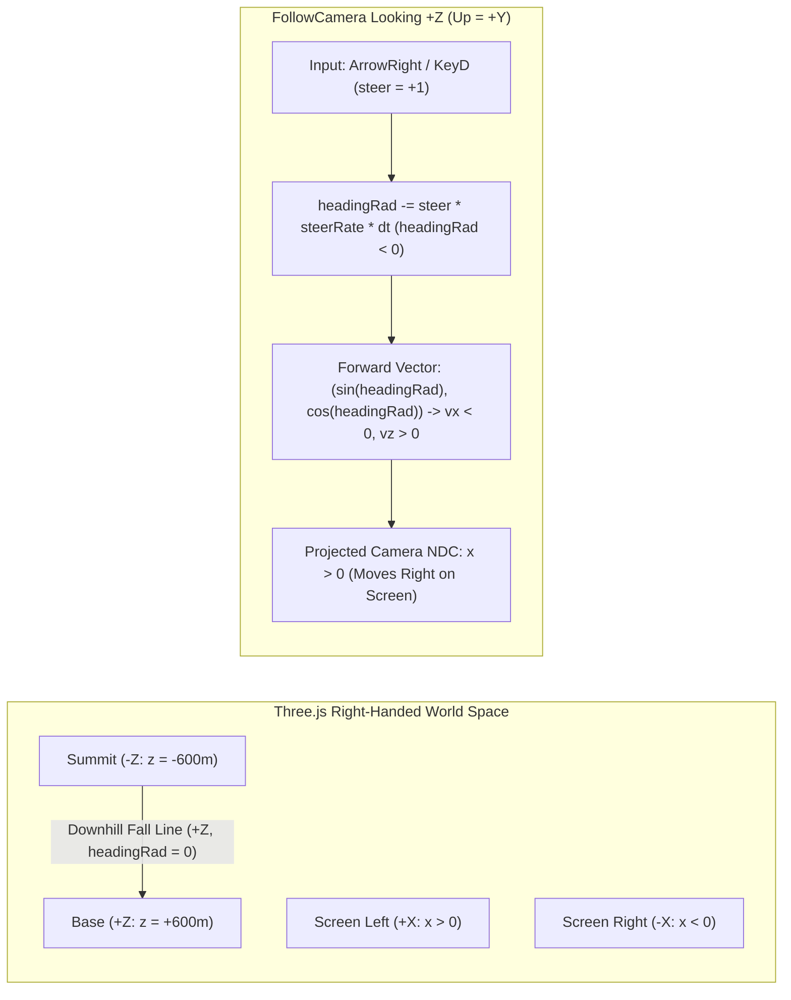

# ADR-0006: Code Review Guardrails and Coordinate Conventions

- **Status:** Accepted
- **Date:** 2026-10-18
- **Iteration:** `feat/v1-core-game`
- **Related Review:** [PR #1 Opus 5.5 Principal Code Review](../reviews/pr-0001-opus-review.md)

## Context

During the Principal Code Review of PR #1 (`feat/v1-core-game`), ad-hoc physics, camera projection, and GLB binary probes uncovered several subtle integration defects that passed initial unit and E2E suites:
1. **Mirrored Screen-Space Steering (B1):** Unit tests verified that `steer = +1` increased `headingRad`, moving the player toward world `+X`. However, because downhill is `+Z` and `FollowCamera` sits behind the player looking toward `+Z` with world up `+Y`, camera right in Three.js right-handed coordinates is world `-X`. Consequently, pressing `ArrowRight` / `KeyD` steered the snowboarder to the **left** side of the screen (`NDC x < 0`).
2. **Async Initialization & Drop-In Race (B2):** `TerrainManager.initialize()` was not idempotent, and `GameApp` allowed drop-in button clicks before the asynchronous `.glb` fetch completed, causing duplicate terrain meshes in `rootGroup` and state resets mid-run.
3. **GLB Material & Metadata Stripping (B3, M10, M11):** Core glTF 2.0 does not serialize Three.js's `material.flatShading` boolean, causing `GLTFLoader` to hydrate smooth-shaded meshes (`flatShading: false`). Additionally, DEM metadata was not embedded in glTF `extras`/`userData`, the synthetic ridge wave pushed peak elevation to `2,259m` (above Whistler's `2,182m` summit), and `harmony-ridge` had an obstacle (`tree_27`) on the fall line 2.9 seconds below spawn.
4. **Crash Physics Invariants (B4, M12):** Obstacle contacts ignored `config.crashSpeedThresholdKmh` (`28 km/h`), slope acceleration continued during `isCrashed === true`, riders passed through obstacle cylinders without radial push-out, and reaching the bottom boundary (`z >= 585m`) trapped the player at ~2 km/h instead of wrapping/resetting cleanly.
5. **E2E Determinism & Production Hygiene (M1–M9):** Focused HUD buttons captured `Space` jump presses, `jump` was level-triggered instead of edge-triggered, returning to the menu left drum/bass stems playing, background `requestAnimationFrame` ticks ran concurrently with E2E `stepSimulation` calls, E2E ran against `vite dev` instead of `vite preview`, and CI granted `pages: write` at the workflow level and deployed `feat/**` branches over production Pages.

## Decision

We adopt the following mandatory architectural conventions and guardrails across all modules and test suites:

### 1. Coordinate System & Screen-Space Steering Convention (B1)



- **Downhill Axis (`+Z`):** The mountain slopes downhill from `-Z` (summit, `z = -length/2`) toward `+Z` (base, `z = +length/2`). A `headingRad` of `0` points straight downhill along `+Z`.
- **Forward Horizontal Unit Vector:** Given `headingRad` ($h$), the horizontal forward direction vector is $(\sin h, \cos h)$ where $v_x = \text{speed} \cdot \sin h$ and $v_z = \text{speed} \cdot \cos h$.
- **Camera Basis (`FollowCamera`):** The chase camera sits behind the rider (`z < player.z`) looking forward toward `+Z` with world up `(0, 1, 0)`. In Three.js right-handed coordinates, the camera's right-hand basis vector is $\text{forward} \times \text{up} = (0, 0, 1) \times (0, 1, 0) = (-1, 0, 0)$ (world **`-X`**).
- **Steering Sign Rule:**
  - `steer = +1` (`ArrowRight` / `KeyD`) MUST turn the rider toward world **`-X`** by **decrementing** `headingRad` (`headingRad -= input.steer * config.steerRateRadPerSec * dt`), producing $v_x < 0$ and projecting to **screen right (`NDC x > 0`)**.
  - `steer = -1` (`ArrowLeft` / `KeyA`) MUST turn the rider toward world **`+X`** by **incrementing** `headingRad`, producing $v_x > 0$ and projecting to **screen left (`NDC x < 0`)**.
  - `rollRad` MUST bank into the turn (`rollRad = -input.steer * 0.35`).

### 2. Idempotent Async Initialization & Drop-In Gating (B2)

- **Idempotent `TerrainManager.initialize()`:** `TerrainManager.initialize(glbUrl?)` MUST cache its in-flight `Promise<void>` (e.g., `private initPromise: Promise<void> | null`) and clear existing children before attaching `terrain_mesh_group` and `terrain_obstacles` so concurrent or repeated calls never duplicate scene geometry.
- **Ready State & Drop-In Gating:**
  - `OGSnowGlobalState` (`window.__OGSNOW_STATE__`) exposes `ready?: boolean` (set to `false` during boot and `true` only after `TerrainManager.initialize()` and initial scene setup resolve).
  - `GameApp.dropIn(dropZoneId)` MUST await initialization if called early, and `GameApp.init()` MUST NOT overwrite `mode` or reset physics if `mode` has already transitioned to `'riding'`.
  - HUD drop-zone buttons are disabled until initialization finishes.

### 3. GLB Material Enforcement, Metadata Serialization & DEM Bounds (B3, M10, M11)

- **Post-Parse Flat Shading (B3):** Because glTF 2.0 binary serialization strips Three.js `flatShading` material flags, `parseTerrainFromGLBBuffer(buffer)` MUST traverse all loaded `THREE.Mesh` nodes and enforce:
  ```typescript
  material.flatShading = true;
  material.needsUpdate = true;
  ```
- **Embedded Terrain Metadata in GLB (M10):** `buildTerrainMeshFromDEM(data)` attaches `mountainId`, `mountainName`, `region`, `width`, `length`, `segmentsX`, `segmentsZ`, `minElevation`, `maxElevation`, `dropZones`, and `obstacles` into `mesh.userData.terrainMetadata` (serialized into glTF `extras`), and `parseTerrainFromGLBBuffer` restores it onto the returned `THREE.Group.userData.terrainMetadata`.
- **Topographical Elevation Bounds & Scope Note (M11):**
  - For Iteration 1 (`feat/v1-core-game`), Whistler Peak uses a deterministic procedural DEM (`generateWhistlerDEM`) calibrated to Whistler's real vertical bounds (`minElevation = 1520m`, `maxElevation = 2182m`). All ridge and bowl modulations MUST be clamped/normalized so `maxElevation` never exceeds `2,182m`. External GIS GeoTIFF/Mapbox raster tile ingestion is deferred to a future iteration.
  > **Superseded by ADR-0007 (Iteration 2):** The `generateWhistlerDEM()` procedural DEM and its `[1520, 2182]` clamp are replaced by real open-map elevation data (AWS Open Data Terrarium tiles → committed `whistler-dem.bin` / `whistler-terrain.json`). External GIS ingestion is the committed pipeline, not deferred. The `TerrainData` contract, clearance rules, flat-shading, and metadata embedding remain in force and are restated in ADR-0007. **Historical context retained** — from `feat/real-terrain-import` onward, elevation assertions check `minElevation < 1600` and `maxElevation > 2100` (ADR-0007 Rule 4).
- **Spawn Fall-Line Corridor:** Every drop zone MUST enforce both:
  1. A `25m` radial obstacle-free clearance around `(spawnX, spawnZ)`.
  2. A clear downhill fall-line corridor (`|x - spawnX| < 18m` for `z` in `[spawnZ, spawnZ + 80m]`) so an unsteered rider never collides immediately after drop-in.

### 4. Crash Physics Invariants, Edge-Triggered Jump & Boundary Reset (B4, M2, M12)

- **Speed-Gated Crash vs. Low-Speed Deflection (B4):**
  - When `checkObstacleCollision(position, 1.1)` returns an obstacle:
    - First, radially push the rider outside the obstacle cylinder to distance `obs.radius + 1.1` from `(obs.position.x, obs.position.z)`.
    - If `speedKmh < config.crashSpeedThresholdKmh` (`28 km/h`): do **not** trigger a crash (`isCrashed` remains `false`); deflect velocity away from the contact normal and damp speed by 30%.
    - If `speedKmh >= config.crashSpeedThresholdKmh` (`28 km/h`): set `isCrashed = true`, `crashTimerSeconds = config.crashRecoverySeconds` (`1.5s`), and reduce velocity magnitude by 85%.
- **Crash Recovery Freeze (B4):** While `isCrashed === true` (`crashTimerSeconds > 0`), `PhysicsEngine.step()` MUST skip downhill slope gravity drive, skip steering/carving/jumping, and apply strong crash deceleration friction so the rider comes to a halt rather than accelerating through obstacles.
- **Rising-Edge Jump Detection (M2):** `PhysicsEngine` tracks `wasJumpPressed` and triggers a jump impulse only on the rising edge (`input.jump && !this.wasJumpPressed && isGrounded && !isCrashed`).
- **Fixed Sub-Stepping & Finite `dt` Guard:** `PhysicsEngine.step(dtSeconds)` guards against non-finite `dtSeconds` (`!Number.isFinite(dtSeconds) || dtSeconds <= 0`) and sub-steps integration in fixed increments (`<= 1/60s`).
- **Bottom Boundary Clean Reset (M12):** Reaching the bottom of the mountain (`z >= length / 2 - 15`) cleanly wraps/resets the player back to the active drop zone (`resetAtDropZone(activeDropZone)`).

### 5. E2E Determinism, Input Focus & CI/CD Security (M1, M3–M9)

- **HUD Focus Management (M1):** All HUD buttons (`btn-mute-audio`, `btn-return-menu`, drop-zone buttons) call `(e.currentTarget as HTMLElement).blur()` on click so pressing `Space` to jump never triggers a focused button. `PlayerController` calls `e.preventDefault()` on game control keys when riding.
- **Menu Audio Ducking (M3):** `GameApp.returnToMenu()` immediately updates `JungleAudioEngine` with a zero-speed state so `bassGain` and `drumGain` duck to `0` (`activeStems = ['pad']`).
- **Deterministic Pause Hook for E2E (M4):** `window.__OGSNOW_APP__` exposes `setPaused?: (paused: boolean) => void`, and `stepSimulation(dt, overrideInput)` restores the prior input override after stepping so E2E tests can pause the background `requestAnimationFrame` loop and step physics deterministically.
- **Real Keyboard & WebGL E2E Verification (M5, M6, M7):**
  - `window.__OGSNOW_STATE__` exposes `webglActive?: boolean`.
  - `playwright.config.ts` runs against the production build (`npm run build && npm run preview -- --port 4173`).
  - `tests/e2e/gameplay.spec.ts` tests real `page.keyboard.down('ArrowRight')` / `'ArrowLeft'` inputs and asserts `webglActive === true`.
- **CI Least Privilege & Main-Only Pages Deploy (M8, M9):**
  - `.github/workflows/ci.yml` sets top-level permissions to `contents: read` only.
  - `pages: write`, `id-token: write`, and `concurrency: { group: 'pages', cancel-in-progress: false }` are scoped strictly to the `deploy-pages` job, which runs only on pushes to `main` or `master` (`if: github.event_name == 'push' && (github.ref == 'refs/heads/main' || github.ref == 'refs/heads/master')`).
  - `build-and-test` runs `npm run generate-glb && git diff --exit-code public/assets/whistler-peak.glb` to guarantee the committed binary `.glb` never drifts from `glbPipeline.ts`.

## Consequences

- **Positive:**
  - Eliminates screen-space steering inversion, async race conditions, smooth-shading regressions, and non-deterministic E2E flakes.
  - Protects production GitHub Pages from being overwritten by unmerged feature branches and enforces least-privilege CI token permissions.
- **Negative:**
  - Requires all unit and E2E tests to respect the `+Z` downhill / `-X` screen-right coordinate convention and `28 km/h` crash speed threshold.

## Strict Compliance Rules

1. Pressing `ArrowRight` (`steer = +1`) MUST decrement `headingRad`, move the rider toward world `-X`, and project to positive camera NDC `x > 0`.
2. `parseTerrainFromGLBBuffer()` MUST return meshes with `material.flatShading === true` and preserve `userData.terrainMetadata`.
3. `TerrainManager.initialize()` MUST be idempotent, and `window.__OGSNOW_STATE__.ready` MUST be `true` after initialization completes.
4. Obstacle contacts below `config.crashSpeedThresholdKmh` (`28 km/h`) MUST deflect without crashing; contacts `>= 28 km/h` MUST set `isCrashed = true`, push the rider outside the obstacle radius, and halt slope gravity acceleration during recovery.
5. Every future PR MUST pass the [PR #1 Opus Review Verification Checklist](../reviews/pr-0001-opus-review.md#4-mandatory-verification-checklist-for-future-sub-agents).
