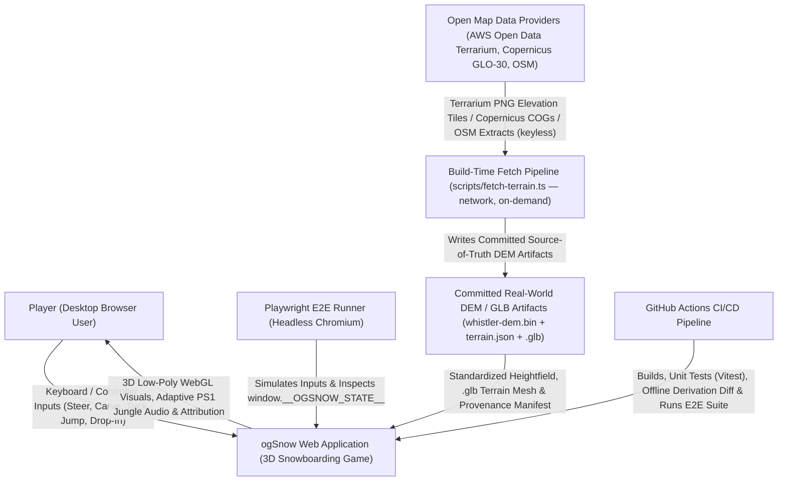
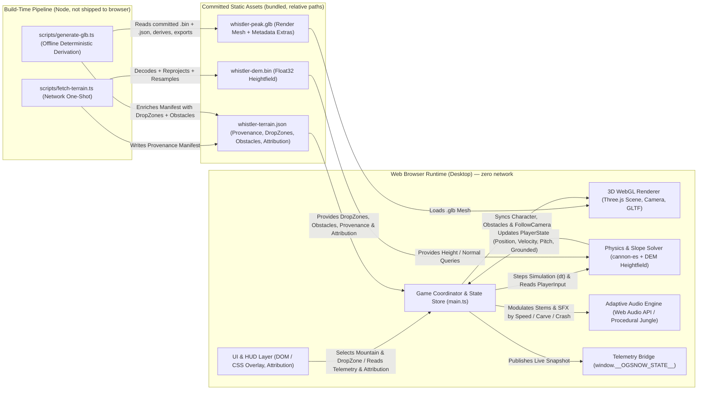
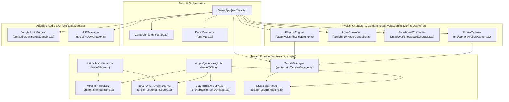
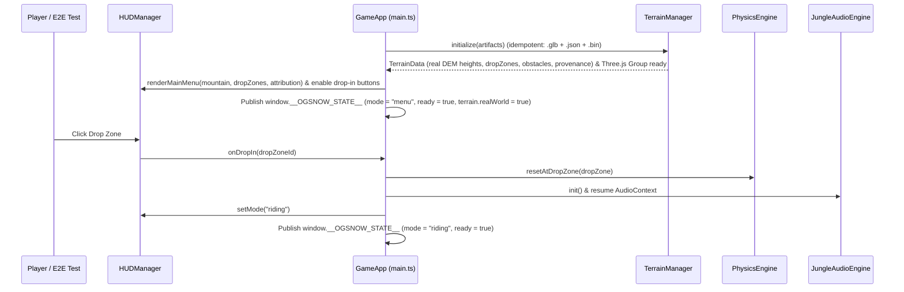
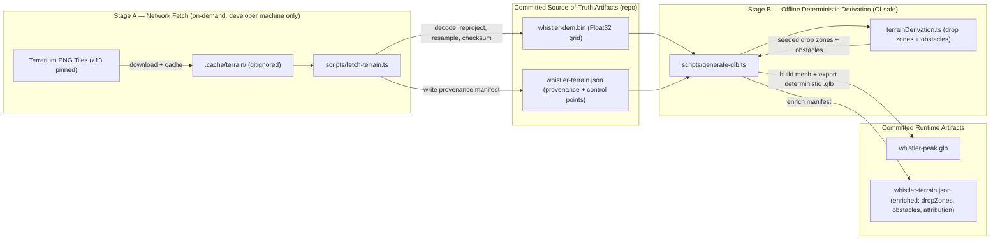
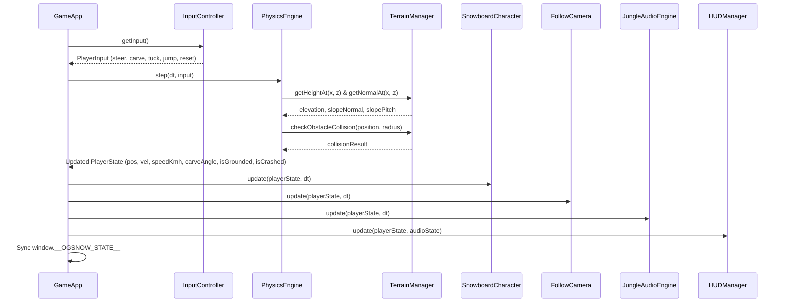
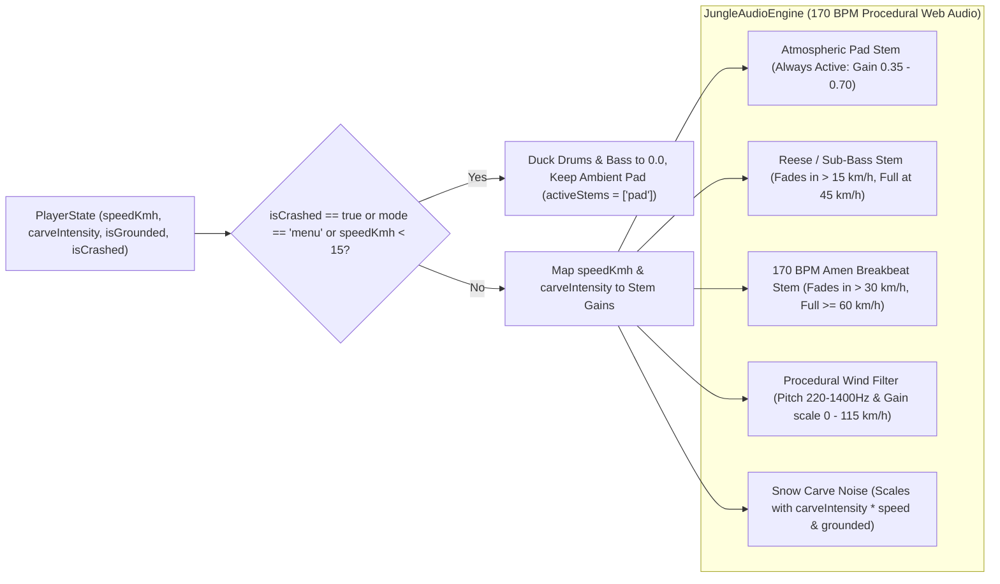
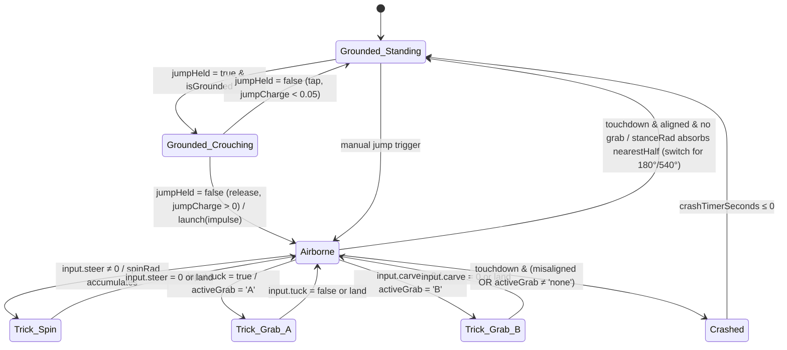

# System Architecture (C4 Model)

This document defines the system architecture of **ogSnow** using the **C4 Model** (System Context, Containers, Components, and Code/Sequence Flows).

---

## 1. System Context (C1)

At the highest level, **ogSnow** is a self-contained browser-based 3D snowboarding simulation accessed by players and automated verification suites, built and deployed via GitHub Actions.



---

## 2. Container Architecture (C2)

Inside the browser runtime, **ogSnow** executes within a single-page TypeScript/Vite application divided into five primary runtime containers plus a build-time/runtime `.glb` terrain asset pipeline.



---

## 3. Component Architecture (C3)

Each container is decomposed into strictly typed ES modules with single responsibilities and zero circular dependencies.



### Component Responsibilities

| Component | File Path | Responsibility |
| :--- | :--- | :--- |
| `Types` | `src/types.ts` | Canonical TypeScript interfaces (`PlayerState`, `TerrainData`, `DropZone`, `AudioState`, `GameConfig`, `OGSnowGlobalState`) plus optional provenance fields (`GeoOrigin`, `TerrainSourceMetadata`, `SampledControlPoint`). |
| `Config` | `src/config.ts` | Default physics constants, Whistler Peak metadata, drop zones, audio BPM/thresholds, camera parameters. |
| `Registry` | `src/terrain/mountains.ts` | Pure-data mountain registry (`MOUNTAIN_REGISTRY`, `getMountainById`): origin, extent, zoom, grid segments, tree line, license/attribution, pinned tiles. |
| `Source` | `src/terrain/terrainSource.ts` | **Node-only.** Terrarium tile URL builder, PNG RGB decode, EPSG:3857 ↔ lat/lon, rotated-rectangle ENU sampling, `Float32` resample, provenance builder. Never imported by browser code. |
| `Derivation` | `src/terrain/terrainDerivation.ts` | Deterministic, seeded drop-zone selection (sustained steep fall lines, spacing, spawn clearance) and obstacle derivation (tree line, slope, curvature; optional OSM refinement hook). Browser-safe (no `node:` imports) for unit testing. |
| `GLBPipeline` | `src/terrain/glbPipeline.ts` | Assembles `TerrainData`, builds low-poly vertex-colored Three.js geometry, exports/loads `.glb` (`GLTFExporter` / `GLTFLoader`). No synthetic heightfield. |
| `TerrainManager` | `src/terrain/TerrainManager.ts` | Loads committed `.glb` + `.json` + `.bin`, reconstructs `TerrainData`, manages mesh + obstacles, bilinear `getHeightAt(x,z)`/`getNormalAt(x,z)`. |
| `Fetch` | `scripts/fetch-terrain.ts` | Node CLI (`npm run fetch-terrain -- --mountain <id>`): downloads pinned tiles → `.cache/terrain/`, decodes/reprojects/resamples, writes `<id>-dem.bin` + `<id>-terrain.json`. |
| `Gen` | `scripts/generate-glb.ts` | Node CLI (offline): reads committed `.bin` + `.json`, runs derivation, exports deterministic `.glb`, enriches manifest. |
| `PhysicsEngine` | `src/physics/PhysicsEngine.ts` | `cannon-es` world + slope-aligned snowboard dynamics: gravity projection along slope normal, carving deceleration, edge grip, obstacle/boundary collisions, crash recovery, airtime detection, **charge-jump mechanics** (Iteration 3: `jumpCharge` accumulation + release-to-launch), **frozen air heading** (`headingRad` locked at takeoff; `A`/`D` spins only), **spin accumulation** (`spinRad`, ADR-0006 sign convention), **switch-stance persistence** (`stanceRad` absorbs nearest-180° multiple on clean landing; reset on crash/reset), and **trick landing evaluation** (alignment tolerance + grab-on-touchdown crash rule). |
| `InputController` | `src/player/PlayerController.ts` | Captures keyboard (`WASD` / Arrow keys / `Space` / `R`) and Gamepad inputs, plus programmatic input injection for E2E testing. |
| `SnowboardCharacter` | `src/player/SnowboardCharacter.ts` | Low-poly PS1-style 3D snowboarder + board mesh hierarchy with procedural lean, carve tilt, pitch alignment, snow spray particles, **crouch/wind-up pose** (Iteration 3: interpolated from `jumpCharge`), **spin visual rotation** (`spinRad` + persistent `stanceRad` yaw; grounded shortest-path ease to stance), **grab A/B arm poses** (`activeGrab`), and **landing squash** (brief compression on touchdown). |
| `FollowCamera` | `src/camera/FollowCamera.ts` | Third-person dynamic chase camera that interpolates position, look-at target, pitch tilt, and FOV (`62°` to `84°`) based on speed and slope pitch, with instant snap on drop-in/reset. |
| `JungleAudioEngine` | `src/audio/JungleAudioEngine.ts` | Web Audio API procedural 170 BPM PS1 Jungle/Amen breakbeat synthesizer & mixer. |
| `HUDManager` | `src/ui/HUDManager.ts` | Main menu mountain/drop-zone selector, attribution footer (`data-testid="terrain-attribution"`), HUD speedometer, altitude, audio stems, crash/airtime notifications, **controls legend overlay** (Iteration 3: charge-jump instructions and trick controls; no score display). |
| `GameApp` | `src/main.ts` | Top-level lifecycle orchestrator, `requestAnimationFrame` loop, deterministic `step(dt)` hook, and `window.__OGSNOW_STATE__` publisher (incl. terrain provenance). |

---

## 4. Code & Runtime Sequence Diagrams (C4)

### 4.1 Initialization & Drop-In Flow



### 4.3 Build-Time Terrain Import Data Flow (ADR-0007)




### 4.2 Per-Frame Game Loop (`tick(dt)`)



---

## 5. Adaptive Audio State Machine & Stem Mixing Flow



---

## 6. Iteration 3 — Charge-Jump & Trick Flow (ADR-0008)

### 6.1 Charge-and-Release Jump State Machine



### 6.2 Per-Frame Charge-Jump & Trick Evaluation Sequence

```mermaid
sequenceDiagram
    participant Input as PlayerController
    participant Phys as PhysicsEngine
    participant Terrain as TerrainManager
    participant Char as SnowboardCharacter
    participant HUD as HUDManager

    Input->>Phys: PlayerInput (jumpHeld, steer, tuck, carve)
    
    alt isGrounded && jumpHeld && !isCrashed
        Phys->>Phys: jumpCharge += dt / jumpChargeMaxSeconds (clamp [0,1])
        Phys->>Phys: effectiveSteerRate *= crouchSteerRateMultiplier (0.4)
        Phys->>Char: state.jumpCharge (for crouch pose interpolation)
    else isGrounded && !jumpHeld && jumpCharge > 0
        Phys->>Phys: impulse = jumpMinImpulse + jumpCharge*(jumpMaxImpulse - jumpMinImpulse)
        Phys->>Phys: velocity.y = impulse; isGrounded = false; jumpCharge = 0
    end

    alt !isGrounded (Airborne)
        Phys->>Phys: headingRad FROZEN at takeoff value (no air steering; camera stays locked behind direction of travel)
        Phys->>Phys: spinRad -= input.steer * spinRateRadPerSec * dt (steer=+1/D decrements: clockwise/screen-right, ADR-0006 sign)
        
        alt input.tuck && !wasActiveGrab
            Phys->>Phys: activeGrab = 'A' (indy/method)
        else input.carve > 0 && !wasActiveGrab
            Phys->>Phys: activeGrab = 'B' (melon/tail)
        else !input.tuck && !input.carve
            Phys->>Phys: activeGrab = 'none'
        end

        Phys->>Char: state.stanceRad + state.spinRad, state.activeGrab (for visual yaw & grab poses)
    end

    Phys->>Terrain: getHeightAt(x, z) (check touchdown)
    
    alt touchdown (isGrounded transition)
        Phys->>Phys: nearestHalf = round(spinRad / π) * π
        Phys->>Phys: alignmentError = |spinRad - nearestHalf|
        
        alt alignmentError > landAlignmentToleranceRad (π/3) OR activeGrab ≠ 'none'
            Phys->>Phys: isCrashed = true; velocity *= 0.15; crashTimerSeconds = crashRecoverySeconds; stanceRad = 0
            Phys->>Char: crash tumble animation
        else
            Phys->>Phys: stanceRad = (stanceRad + nearestHalf) mod 2π (180°/540° → switch, 360° → normal); spinRad = 0; activeGrab = 'none'
            Phys->>Char: landing squash animation
        end
    end

    Phys-->>HUD: PlayerState (jumpCharge, spinRad, stanceRad, activeGrab, isCrashed)
```

### 6.3 Input Interpretation (Ground vs. Air)

| Input Key | Grounded Meaning | Airborne Meaning (ADR-0008) |
| :--- | :--- | :--- |
| `A` / `←` | Steer left (+X) | Spin frontside (spinRad increments — counterclockwise/screen-left) |
| `D` / `→` | Steer right (-X) | Spin backside (spinRad decrements — clockwise/screen-right) |
| `W` / `↑` | Tuck (aerodynamic boost) | Grab A (indy/method) |
| `S` / `↓` | Carve/brake (slow down) | Grab B (melon/tail) |
| `Space` | Hold to charge jump; release to launch | No effect (already airborne) |
| `R` | Reset to drop zone | Reset to drop zone |
| Gamepad `A` | Charge/release jump | No effect (already airborne) |
| Gamepad analog stick | Steer left/right | Spin left/right |
| Gamepad `LT`/`B` | Carve/brake | Grab B |
| Gamepad `RT` | Tuck | Grab A (alternative mapping) |

**Airborne heading policy (ADR-0008, amended 2026-10-24):** while airborne the travel heading `headingRad` is **frozen** at its takeoff value — none of the airborne inputs above rotate the heading or the follow camera; `A`/`D` (or the stick) only spin the character (`spinRad`, sharing `headingRad`'s sign convention: `D` decrements → clockwise/screen-right). Steering authority returns on touchdown.

**Switch-stance persistence (ADR-0008, round-2 amendment 2026-10-24):** a clean landing absorbs the nearest `180°` multiple of `spinRad` into `stanceRad` (`180°`/`540°` → switch/goofy, `360°`/`720°` → normal; crash/reset → normal). While grounded the character eases its visual yaw to `stanceRad` (shortest path); while airborne the visual yaw is `stanceRad + spinRad`. `stanceRad` is visual-only and never affects heading, velocity, or obstacles.
