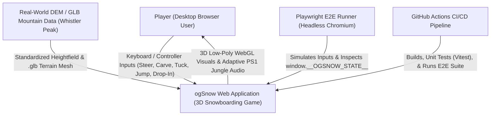
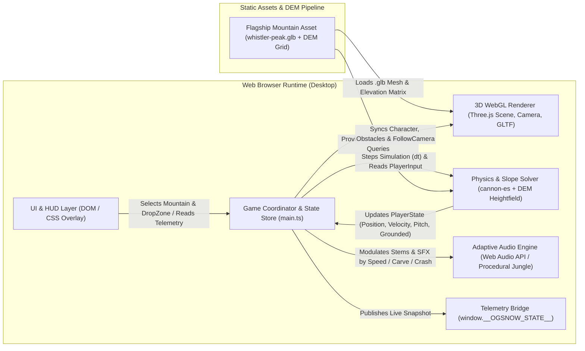
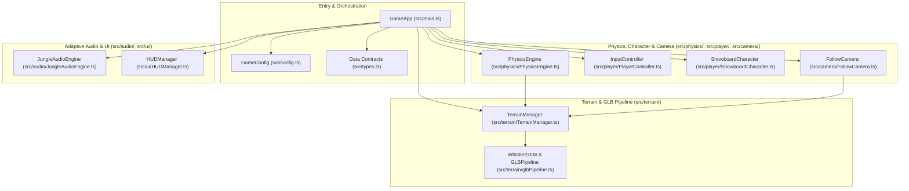
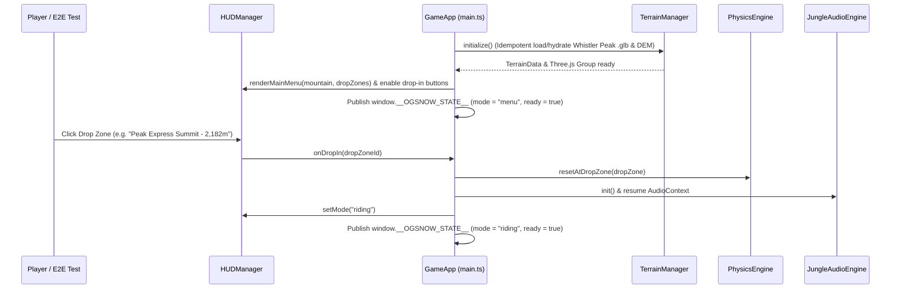
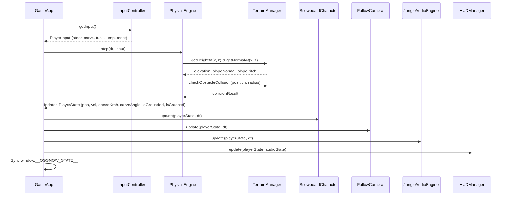
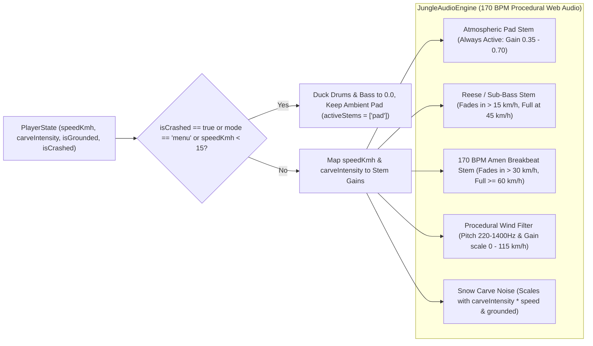

# System Architecture (C4 Model)

This document defines the system architecture of **ogSnow** using the **C4 Model** (System Context, Containers, Components, and Code/Sequence Flows).

---

## 1. System Context (C1)

At the highest level, **ogSnow** is a self-contained browser-based 3D snowboarding simulation accessed by players and automated verification suites, built and deployed via GitHub Actions.

---

## 2. Container Architecture (C2)

Inside the browser runtime, **ogSnow** executes within a single-page TypeScript/Vite application divided into five primary runtime containers plus a build-time/runtime `.glb` terrain asset pipeline.

---

## 3. Component Architecture (C3)

Each container is decomposed into strictly typed ES modules with single responsibilities and zero circular dependencies.

### Component Responsibilities

| Component | File Path | Responsibility |
| :--- | :--- | :--- |
| `Types` | `src/types.ts` | Canonical TypeScript interfaces (`PlayerState`, `TerrainData`, `DropZone`, `AudioState`, `GameConfig`, `OGSnowGlobalState`). |
| `Config` | `src/config.ts` | Default physics constants, Whistler Peak metadata, 3 drop zones, audio BPM/thresholds, camera parameters. |
| `GLBPipeline` | `src/terrain/glbPipeline.ts` | Generates deterministic Whistler Peak DEM heightmap data, builds low-poly vertex-colored Three.js geometry, exports/loads `.glb` binary buffers (`GLTFExporter` / `GLTFLoader`). |
| `TerrainManager` | `src/terrain/TerrainManager.ts` | Manages the 3D mountain mesh, natural obstacles (trees, rocks, cliffs), bilinear height/normal queries `getHeightAt(x, z)` and `getNormalAt(x, z)`. |
| `PhysicsEngine` | `src/physics/PhysicsEngine.ts` | `cannon-es` world + slope-aligned snowboard dynamics: gravity projection along slope normal, carving deceleration, edge grip, obstacle/boundary collisions, crash recovery, and airtime detection. |
| `InputController` | `src/player/PlayerController.ts` | Captures keyboard (`WASD` / Arrow keys / `Space` / `R`) and Gamepad inputs, plus programmatic input injection for E2E testing. |
| `SnowboardCharacter` | `src/player/SnowboardCharacter.ts` | Low-poly PS1-style 3D snowboarder + board mesh hierarchy with procedural lean, carve tilt, pitch alignment, and snow spray particles. |
| `FollowCamera` | `src/camera/FollowCamera.ts` | Third-person dynamic chase camera that interpolates position, look-at target, pitch tilt, and FOV (`62°` to `84°`) based on speed and slope pitch, with instant snap on drop-in/reset. |
| `JungleAudioEngine` | `src/audio/JungleAudioEngine.ts` | Web Audio API procedural 170 BPM PS1 Jungle/Amen breakbeat synthesizer & mixer: atmospheric pad stem, bassline stem (`> 15 km/h`), breakbeat drum stem (`> 30 km/h`, full `>= 60 km/h`), wind noise generator, and snow-carve bandpass filter. |
| `HUDManager` | `src/ui/HUDManager.ts` | Main menu mountain/drop-zone selector, HUD speedometer (`km/h`), altitude/vertical drop meter, audio stem activity indicators, and crash/airtime notifications. |
| `GameApp` | `src/main.ts` | Top-level lifecycle orchestrator, `requestAnimationFrame` loop, deterministic `step(dt)` hook, and `window.__OGSNOW_STATE__` publisher. |

---

## 4. Code & Runtime Sequence Diagrams (C4)

### 4.1 Initialization & Drop-In Flow

### 4.2 Per-Frame Game Loop (`tick(dt)`)

---

## 5. Adaptive Audio State Machine & Stem Mixing Flow

