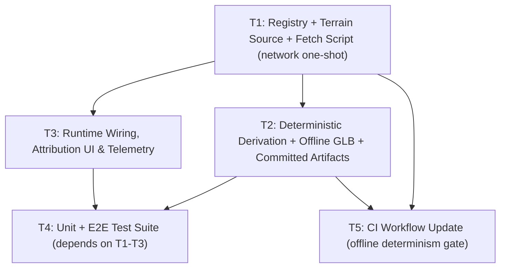

# Iteration 2 Task Decomposition (`feat/real-terrain-import`)

This document decomposes Iteration 2 (Real-World Open-Map Terrain Import) into five self-contained tasks for Execution, Testing, and CI/CD Sub-Agents. Every Sub-Agent MUST read `wiki/README.md`, `wiki/architecture.md`, `wiki/interfaces.md`, `wiki/adr/0001-*.md` through `0007-*.md`, and `wiki/reviews/pr-0001-opus-review.md` before writing code. The locked decisions and strict compliance rules live in **ADR-0007**; this file is the dispatchable spec.

---

## Execution Order & Parallelism Graph

- **Wave 1 (Foundation):** T1 (`src/terrain/mountains.ts`, `src/terrain/terrainSource.ts`, `scripts/fetch-terrain.ts`, `src/types.ts`, `src/config.ts`, `.gitignore`, `package.json`) delivers the registry + Node-only terrain source + the network fetch script and generates the **committed** `whistler-dem.bin` + `whistler-terrain.json`.
- **Wave 2 (parallel):** T2 (`src/terrain/terrainDerivation.ts`, `src/terrain/glbPipeline.ts`, `scripts/generate-glb.ts`, regenerated `whistler-peak.glb`) and T3 (`src/terrain/TerrainManager.ts`, `src/main.ts`, `src/ui/HUDManager.ts`, `src/style.css`) run in parallel (no file overlap). T5 (`ci.yml`) can start once T1/T2 contracts are known.
- **Wave 3 (verification):** T4 (all tests + Playwright) depends on T1–T3 integrated output. T5 finalizes the CI gate after T2's determinism contract is proven.

---

## Task T1: Mountain Registry, Node-Only Terrain Source & Fetch Script

- **Assigned Role:** Execution Sub-Agent T1 (Terrain Source & Fetch Pipeline)
- **Owned Files (new):**
  - `src/terrain/mountains.ts`
  - `src/terrain/terrainSource.ts`
  - `scripts/fetch-terrain.ts`
- **Owned Files (changed):**
  - `.gitignore` (add `.cache/terrain/`)
  - `package.json` (add `"fetch-terrain": "tsx scripts/fetch-terrain.ts"`)
  - `src/types.ts` (add `GeoOrigin`, `PinnedTile`, `SampledControlPoint`, `TerrainTileRecord`, `TerrainSourceMetadata`, `TerrainDerivation`, `TerrainManifest`, and optional fields on `TerrainData` + `GameConfig.attribution?` + `OGSnowGlobalState.terrain` provenance — per `wiki/interfaces.md` §2/§2.1)
  - `src/config.ts` (set `mountainName`, `region`, `attribution`; keep physics/audio/camera constants unchanged; drop zones are re-derived by T2, so `dropZones` may be seeded from the manifest at runtime)
- **Generated committed artifacts (written by this task):**
  - `public/assets/terrain/whistler-dem.bin`
  - `public/assets/terrain/whistler-terrain.json`
- **Detailed Requirements:**
  1. `src/terrain/mountains.ts`: pure-data `MOUNTAIN_REGISTRY` + `getMountainById`. Whistler entry EXACTLY as ADR-0007 §3 (origin `50.0596/-122.9570`, azimuth `180`, extent `1600×3200`, zoom `13`, grid `128×256`, tree line `1650`, pinned z13 tiles `(1297,2775)`,`(1298,2775)`,`(1297,2776)`,`(1298,2776)`). No imports from `terrainSource.ts`.
  2. `src/terrain/terrainSource.ts` (Node-only, `node:https`/`node:zlib`/`node:crypto`): `terrariumTileUrl`, `lonLatToWebMercatorPixels`, `webMercatorPixelsToLonLat`, `decodeTerrariumPng` (R*256 + G + B/256 − 32768), `metersPerDegLat`/`metersPerDegLon`, `enuToGame`/`gameToEnu` (ADR-0007 §5), `resampleToGrid`, `sha256Hex`, `buildSourceMetadata`. MUST NOT be imported by browser code.
  3. `scripts/fetch-terrain.ts`: CLI `npm run fetch-terrain -- --mountain whistler`; cache tiles under `.cache/terrain/<z>/<x>/<y>.png`; **fail loudly** (exit 1) on any non-200/undecodable/missing-coverage tile; decode, reproject, resample; write `<id>-dem.bin` (little-endian `Float32`, row-major) + `<id>-terrain.json` (stable serializer, ≥16 `sampledControlPoints`, per-tile SHA-256, real `min/maxElevation`, NO timestamps).
  4. Run the fetch once on the developer machine to produce and commit the artifacts (this is the ONLY network step in the entire workflow).
- **Acceptance Criteria:**
  - `npm run fetch-terrain -- --mountain whistler` exits 0 and produces `whistler-dem.bin` (exactly `(257 × 129) × 4` bytes) + `whistler-terrain.json`.
  - JSON records `minElevation < 1600` and `maxElevation > 2100` (never `[1520, 2182]`), `source.provider === 'aws-terrarium'`, `zoom === 13`, `pinnedTiles` checksums present.
  - `tsc --noEmit` passes; browser bundle has no reference to `terrainSource.ts` (verify via `vite build` + grep of `dist/` for `node:https`/`terrarium`).
- **Verification Commands:** `npm run fetch-terrain -- --mountain whistler && npm run build && ls -l public/assets/terrain/`

---

## Task T2: Deterministic Derivation + Offline GLB + Committed Artifacts

- **Assigned Role:** Execution Sub-Agent T2 (Derivation & GLB Pipeline)
- **Owned Files (new):**
  - `src/terrain/terrainDerivation.ts`
- **Owned Files (changed):**
  - `src/terrain/glbPipeline.ts` (replace `generateWhistlerDEM` with `assembleTerrainData`; keep `buildTerrainMeshFromDEM`/`exportTerrainToGLBBuffer`/`parseTerrainFromGLBBuffer`)
  - `scripts/generate-glb.ts` (offline: read `.bin`+`.json`, derive, export deterministic `.glb`, enrich manifest)
- **Generated committed artifacts (regenerated by this task):**
  - `public/assets/whistler-peak.glb`
  - `public/assets/terrain/whistler-terrain.json` (enriched with `dropZones`, `obstacles`, `derivation`)
- **Detailed Requirements:**
  1. `src/terrain/terrainDerivation.ts` (browser + Node safe, no `node:` imports): `deriveDropZones`, `deriveObstacles`, `deriveTerrain`. Deterministic (seeded PRNG = FNV-1a of `mountainId`; fixed row-major order; stable ids). Drop zones: sustained steep fall lines, ≥min spacing, ≥25 m obstacle-free radius + 80 m downhill corridor. Obstacles: trees below `treeLineElevationM` on low-slope/curvature cells, rocks/cliffs on steep/curvature cells; optional `osmRefine` hook (unused for committed Whistler).
  2. `src/terrain/glbPipeline.ts`: implement `assembleTerrainData(manifest, heights)`; DELETE `generateWhistlerDEM` synthetic spline (ADR-0007 Rule 1). Keep GLB build/export/parse contracts intact (flat shading, metadata extras).
  3. `scripts/generate-glb.ts`: read committed artifacts; **exit 1** if missing/invalid (never synthesize); run `deriveTerrain`; build mesh; export `.glb`; enrich + rewrite `whistler-terrain.json` (stable ordering, no timestamps).
  4. Run `npm run generate-glb` twice; assert byte-identical outputs.
- **Acceptance Criteria:**
  - `npm run generate-glb` exits 0; outputs valid `.glb` (magic `0x46546C67`), enriched `whistler-terrain.json`.
  - Two consecutive runs byte-identical (compare `sha256sum` of `.glb` and `.json`).
  - Derived drop zones/obstacles satisfy ADR-0002 Rule 2 clearance.
  - `git diff --exit-code public/assets/whistler-peak.glb public/assets/terrain/whistler-terrain.json` clean after regeneration.
- **Verification Commands:** `npm run generate-glb && npm run generate-glb && git diff --exit-code public/assets/whistler-peak.glb public/assets/terrain/whistler-terrain.json`

---

## Task T3: Runtime Wiring, Attribution UI & Telemetry

- **Assigned Role:** Execution Sub-Agent T3 (Runtime Integration & UI)
- **Owned Files (changed):**
  - `src/terrain/TerrainManager.ts` (load `.glb` + `.json` + `.bin`; `assembleTerrainData`; `TerrainArtifacts` options; idempotent)
  - `src/main.ts` (construct `TerrainManager` with committed artifact paths; publish provenance in `window.__OGSNOW_STATE__.terrain`)
  - `src/ui/HUDManager.ts` (render `[data-testid="terrain-attribution"]` footer from `config.attribution`)
  - `src/style.css` (style attribution footer)
- **Detailed Requirements:**
  1. `TerrainManager.initialize(artifacts?)` loads `./assets/whistler-peak.glb`, `./assets/terrain/whistler-terrain.json`, `./assets/terrain/whistler-dem.bin` via relative `fetch`; reconstructs `terrainData` (heights, dropZones, obstacles, provenance); idempotent; throws on missing/invalid (no synthetic fallback).
  2. `main.ts` passes `config.attribution` (from the manifest) and publishes `terrain.realWorld`, `terrain.source`, `terrain.origin`, `terrain.attribution`, `terrain.minElevation`, `terrain.maxElevation`, `terrain.demFormatVersion` into `window.__OGSNOW_STATE__`.
  3. `HUDManager` renders the attribution footer (`data-testid="terrain-attribution"`) via `textContent`; HUD altitude continues to show `player.altitudeMeters` (now real-world).
  4. Preserve ADR-0006 contracts exactly: downhill `+Z`, `steer=+1 → headingRad` decrement → world `-X`. Do NOT touch `PhysicsEngine`, `PlayerController`, `SnowboardCharacter`, `FollowCamera`, `JungleAudioEngine`.
- **Acceptance Criteria:**
  - Runtime performs zero external network requests (all fetches are relative bundled assets).
  - `window.__OGSNOW_STATE__.terrain.realWorld === true`, `attribution` non-empty, `minElevation < 1600`, `maxElevation > 2100`.
  - `[data-testid="terrain-attribution"]` visible in main menu with the Terrarium attribution string.
  - `npm run build && npm run preview` boots with `ready === true` and `webglActive === true`.
- **Verification Commands:** `npm run build && npm run preview -- --port 4173` (manual smoke) — formal E2E in T4.

---

## Task T4: Unit + E2E Test Suite (Vitest + Playwright)

- **Assigned Role:** Testing & E2E Sub-Agent
- **Owned Files (new):**
  - `tests/unit/terrainSource.test.ts` (geodesy/reproject/decode, pure offline)
  - `tests/unit/terrainDerivation.test.ts` (seeded determinism + clearance)
- **Owned Files (changed/rewritten):**
  - `tests/unit/terrain.test.ts` (rewrite: read committed `.bin`+`.json` via `fs`, assert real bounds + provenance + GLB invariants + idempotent init)
  - `tests/unit/physics.test.ts` (update fixtures to real terrain; keep ADR-0003/0006 invariants identical)
  - `tests/e2e/gameplay.spec.ts` (add attribution + real-altitude + provenance assertions)
  - `playwright.config.ts` (unchanged unless needed)
- **Detailed Requirements:**
  1. `terrainSource.test.ts`: verify `lonLatToWebMercatorPixels`/inverse round-trip, `decodeTerrariumPng` on a committed/embedded fixture (or a tiny in-memory PNG), `enuToGame`/`gameToEnu` round-trip and that azimuth 180 maps north-vector to `−Z`, and `resampleToGrid` grid dims. Zero network.
  2. `terrainDerivation.test.ts`: same seed twice → identical `dropZones`/`obstacles`; different seeds → different (but valid) results; every drop zone has ≥25 m radial + 80 m corridor clearance; obstacle count ≤ budget.
  3. `terrain.test.ts`: load `public/assets/terrain/whistler-dem.bin` + `whistler-terrain.json` from disk (fs); assert `minElevation < 1600`, `maxElevation > 2100`, and NOT `[1520,2182]`; compare grid vs `sampledControlPoints` within tolerance; GLB magic/flat-shading/metadata preservation; idempotent `initialize()`.
  4. `physics.test.ts` & `gameplay.spec.ts`: same behavior invariants as Iteration 1 (downhill `+Z`, steering screen-space, carve deceleration, edge-jump, speed-gated crash, stem transitions) against real terrain; add `terrain.realWorld === true` and `[data-testid="terrain-attribution"]` assertions and that HUD altitude equals the imported summit elevation (not 2182 clamp).
- **Acceptance Criteria:**
  - `npm test` and `npm run test:e2e` pass 100%; zero `console.error`/`pageerror`; zero network in tests.
  - Provenance assertions pass without network (committed control points + checksums).
- **Verification Commands:** `npm test && npm run test:e2e`

---

## Task T5: CI Workflow Update (Offline Determinism Gate)

- **Assigned Role:** CI/CD Sub-Agent
- **Owned Files (changed):**
  - `.github/workflows/ci.yml`
- **Detailed Requirements:**
  1. Keep existing least-privilege structure (top-level `contents: read`; job-scoped Pages permissions; `deploy-pages` only on `main`/`master`).
  2. Replace/augment the GLB determinism step with the **offline-only** gate: `npm run generate-glb && git diff --exit-code public/assets/whistler-peak.glb public/assets/terrain/whistler-terrain.json public/assets/terrain/whistler-dem.bin`.
  3. **Do NOT** add `npm run fetch-terrain` to CI (network); CI runs only the offline derivation + diff.
  4. Optionally add a `dist` grep guard asserting no `terrarium`/`node:https` strings leak into the browser bundle.
- **Acceptance Criteria:**
  - CI `build-and-test` runs `npm ci`, `npm run generate-glb` + determinism diff, `npm run build`, `npm test`, Playwright install, `npm run test:e2e`, uploads artifacts — all with zero network.
  - Determinism gate fails loudly if `.glb`/`.json`/`.bin` drift.
- **Verification Commands:** push/PR triggers the workflow (or `act` local dry-run).
