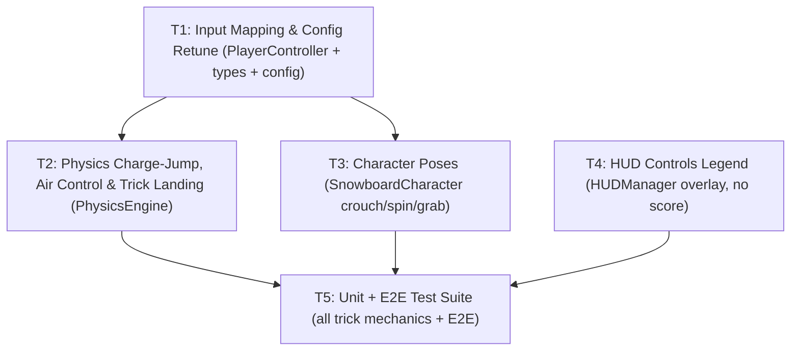

# Iteration 3 Task Decomposition (`feat/charge-jump-tricks`)

This document decomposes Iteration 3 (Charge Jump, Crouch & Tricks) into five self-contained tasks for Execution, Character/Visual, UI, and Testing Sub-Agents. Every Sub-Agent MUST read `wiki/README.md`, `wiki/architecture.md`, `wiki/interfaces.md`, all active ADRs (`wiki/adr/0001-*.md` through `0008-*.md`), and `wiki/reviews/pr-0001-opus-review.md` before writing code. The locked decisions and strict compliance rules live in **ADR-0008**; this file is the dispatchable spec.

---

## Execution Order & Parallelism Graph



- **Wave 1 (Foundation):** T1 (`PlayerController`, `types.ts`, `config.ts`) delivers the input wire (`jumpHeld`) and config retune (`gravity: 14.0`, charge/trick parameters).
- **Wave 2 (parallel):** T2 (`PhysicsEngine` charge-jump logic, air control, spin, trick landing rule) and T3 (`SnowboardCharacter` crouch/spin/grab poses) run in parallel (no file overlap). T4 (`HUDManager` controls legend) can also run concurrently.
- **Wave 3 (verification):** T5 (unit tests + E2E) depends on T1/T2/T3/T4 integrated.

---

## Task T1: Input Mapping & Config Retune

- **Assigned Role:** Execution Sub-Agent T1 (Input & Configuration)
- **Owned Files (changed):**
  - `src/types.ts` (add `jumpHeld`, `jumpCharge`, `spinRad`, `activeGrab`, new config fields)
  - `src/config.ts` (gravity `14.0`, add `jumpChargeMaxSeconds`, `jumpMinImpulse`, `jumpMaxImpulse`, `crouchSteerRateMultiplier`, `airSteerRateMultiplier`, `spinRateRadPerSec`, `landAlignmentToleranceRad`; keep `jumpImpulse` but mark deprecated)
  - `src/player/PlayerController.ts` (add `jumpHeld` tracking, gamepad `A` button mapping for charge-jump)
- **Detailed Requirements:**

### 1.1 TypeScript Contract Updates (`src/types.ts`)

`PlayerInput` final shape (the legacy `jump` field is **removed**; `jumpHeld` is the single continuous hold signal):
```typescript
export interface PlayerInput {
  steer: number;         // -1.0 (left) to +1.0 (right)
  carve: number;         // 0.0 (none) to 1.0 (hard braking/carving)
  tuck: boolean;         // true when leaning forward for speed (W / ArrowUp); mid-air = grab A
  jumpHeld: boolean;     // single continuous hold signal: true while Space (or gamepad A) is held
  reset: boolean;        // true when reset to drop-zone requested (R)
}
```

Add to `PlayerState`:
```typescript
export interface PlayerState {
  // ... existing fields ...
  jumpCharge: number;          // NEW: 0.0 to 1.0 (accumulates while jumpHeld + grounded)
  spinRad: number;             // NEW: accumulated spin yaw angle in radians (airborne only; independent of headingRad)
  activeGrab: 'none' | 'A' | 'B'; // NEW: 'A' = indy/method (W), 'B' = melon/tail (S), 'none' on ground/release
}
```

Add to `GameConfig`:
```typescript
export interface GameConfig {
  // ... existing fields ...
  gravity: number;                      // CHANGED: from 22.0 to 14.0
  jumpImpulse: number;                  // DEPRECATED: replaced by jumpMinImpulse/jumpMaxImpulse
  // NEW fields:
  jumpChargeMaxSeconds: number;         // duration to charge 0→1 (e.g. 0.5)
  jumpMinImpulse: number;               // minimal tap impulse (e.g. 4.5 m/s)
  jumpMaxImpulse: number;               // full charge impulse (e.g. 14.0 m/s)
  crouchSteerRateMultiplier: number;    // e.g. 0.4 (40% of normal while charging)
  airSteerRateMultiplier: number;       // e.g. 0.35 (35% of normal while airborne)
  spinRateRadPerSec: number;            // e.g. 3.0 rad/s
  landAlignmentToleranceRad: number;    // e.g. Math.PI / 3 (60°)
}
```

### 1.2 Config Value Updates (`src/config.ts`)

Replace `DEFAULT_GAME_CONFIG`:
```typescript
export const DEFAULT_GAME_CONFIG: GameConfig = {
  // unchanged: mountainName, region, maxSpeedKmh, steerRateRadPerSec, etc.
  gravity: 14.0,                        // CHANGED from 22.0
  jumpImpulse: 7.5,                     // DEPRECATED but retained for compatibility
  jumpChargeMaxSeconds: 0.5,            // NEW
  jumpMinImpulse: 4.5,                  // NEW
  jumpMaxImpulse: 14.0,                 // NEW
  crouchSteerRateMultiplier: 0.4,       // NEW
  airSteerRateMultiplier: 0.35,         // NEW
  spinRateRadPerSec: 3.0,               // NEW
  landAlignmentToleranceRad: Math.PI / 3, // NEW (60°)
  // all other fields unchanged (audio, camera, carve/air drag, crash threshold, etc.)
};
```

### 1.3 PlayerController Input Mapping (`src/player/PlayerController.ts`)

**Changes:**
1. Remove edge-trigger logic for `jump` entirely (delete `spaceJumpConsumed` flag and any `wasJumpHeld` rising-edge state) — the legacy `jump` field no longer exists on `PlayerInput`.
2. Add continuous `jumpHeld` tracking: `jumpHeld` is `true` while `Space` (or gamepad `A`) is held down, `false` when released.
3. Gamepad button 0 (A button) maps to `jumpHeld` in addition to keyboard `Space`.

**Implementation spec:**
```typescript
public getInput(): PlayerInput {
  // ... existing steer/carve/tuck/reset logic unchanged ...

  // jumpHeld: single continuous hold signal — true when Space or gamepad A is held down
  const jumpHeld = this.isPressed('Space') || this.pollGamepadButtonA();

  let input: PlayerInput = { steer, carve, tuck, jumpHeld, reset };

  // ... existing gamepad poll and override logic ...
  return input;
}

private pollGamepadButtonA(): boolean {
  if (typeof navigator === 'undefined' || typeof navigator.getGamepads !== 'function') {
    return false;
  }
  const gamepads = navigator.getGamepads();
  if (!gamepads) return false;
  for (let i = 0; i < gamepads.length; i++) {
    const gp = gamepads[i];
    if (!gp || !gp.connected) continue;
    if (gp.buttons && gp.buttons[0]?.pressed) return true;
  }
  return false;
}
```

**Key points:**
- `handleKeyDown('Space')` / `handleKeyUp('Space')` set/clear `this.keyStates.get('Space')`.
- No `preventDefault()` change required (already applied to `Space` in existing code).
- `pollGamepad()` existing logic for steer/carve/tuck/reset remains unchanged; add `pollGamepadButtonA()` for separate `jumpHeld` check.

- **Acceptance Criteria:**
  - `tsc --noEmit` passes with zero errors on updated types.
  - `npm run build` succeeds; no runtime exceptions.
  - Manual smoke test: holding `Space` updates `window.__OGSNOW_STATE__.player.jumpCharge` from `0.0` to `1.0` over ~0.5 s (verified by T5 tests).

- **Verification Commands:** `npm run build && tsc --noEmit`

---

## Task T2: Physics Charge-Jump, Air Control & Trick Landing

- **Assigned Role:** Execution Sub-Agent T2 (Physics & Air Mechanics)
- **Owned Files (changed):**
  - `src/physics/PhysicsEngine.ts` (replace edge-trigger jump with charge accumulation + release-to-launch; air steering limit; spin accumulation; trick landing evaluation)
- **Detailed Requirements:**

### 2.1 Charge Accumulation (Grounded)

When `input.jumpHeld === true` and `this.state.isGrounded === true` and `!this.state.isCrashed`:
```typescript
this.state.jumpCharge = Math.min(1.0, this.state.jumpCharge + dt / this.config.jumpChargeMaxSeconds);
```

When `input.jumpHeld === false` and `this.state.jumpCharge > 0` (release):
```typescript
const impulse = this.config.jumpMinImpulse + this.state.jumpCharge * (this.config.jumpMaxImpulse - this.config.jumpMinImpulse);
this.state.velocity.y = impulse;
this.state.isGrounded = false;
this.state.jumpCharge = 0;
this.state.airtimeSeconds = 0;
```

**Notes:**
- Very brief tap (release before `jumpCharge` reaches ~`0.05`) still produces near-`jumpMinImpulse` — input never feels dead.
- While airborne (`!isGrounded`), `jumpHeld` has no effect; no re-triggering mid-air.
- On crash or landing, `jumpCharge` resets to `0`.

### 2.2 Crouch Steering Penalty

While `this.state.jumpCharge > 0` (crouching/winding up), effective steering and carve rates scale:
```typescript
const effectiveSteerRate = this.config.steerRateRadPerSec * 
  (this.state.jumpCharge > 0 ? this.config.crouchSteerRateMultiplier : 1.0);
```
Apply `effectiveSteerRate` to `headingRad` update and carve alignment.

### 2.3 Air Control & Spin Accumulation

While `!this.state.isGrounded` (airborne):
```typescript
// Limited air steering (heading adjustment)
const effectiveAirSteer = this.config.steerRateRadPerSec * this.config.airSteerRateMultiplier;
this.state.headingRad -= input.steer * effectiveAirSteer * dt;

// Spin accumulation (visual rotation, independent of heading)
this.state.spinRad += input.steer * this.config.spinRateRadPerSec * dt;

// Grab state (airborne only)
if (input.tuck && this.state.activeGrab === 'none') {
  this.state.activeGrab = 'A'; // indy/method
} else if (input.carve > 0 && this.state.activeGrab === 'none') {
  this.state.activeGrab = 'B'; // melon/tail
} else if (!input.tuck && input.carve === 0) {
  this.state.activeGrab = 'none'; // release
}
```

**Notes:**
- `spinRad` is unbounded; it accumulates continuously while steering airborne.
- Slope acceleration is **disabled** while airborne (existing behavior retained).
- Existing quadratic air drag remains active.

### 2.4 Trick Landing Evaluation

On touchdown (`isGrounded` transition from `false` to `true`):
```typescript
const nearestHalf = Math.round(this.state.spinRad / Math.PI) * Math.PI;
const alignmentError = Math.abs(this.state.spinRad - nearestHalf);

if (alignmentError > this.config.landAlignmentToleranceRad || this.state.activeGrab !== 'none') {
  // Wipeout / bail
  this.state.isCrashed = true;
  this.state.crashTimerSeconds = this.config.crashRecoverySeconds;
  this.state.velocity.x *= 0.15;
  this.state.velocity.z *= 0.15;
  this.state.velocity.y = 0;
} else {
  // Clean landing
  this.state.spinRad = 0;
  this.state.activeGrab = 'none';
}
```

**Notes:**
- `nearestHalf` rounds `spinRad` to the nearest `π` multiple (0°, 180°, 360°, etc.).
- `landAlignmentToleranceRad = π/3` (60°) allows ±60° margin around each 180° milestone.
- Still holding a grab on touchdown (`activeGrab !== 'none'`) always crashes, even if rotation is aligned.
- Existing crash recovery (`crashTimerSeconds`, arrest friction) applies to trick-landing wipeouts.

### 2.5 Initial State & Reset

Initialize `PlayerState` in `buildInitialState()` and `resetAtDropZone()`:
```typescript
jumpCharge: 0,
spinRad: 0,
activeGrab: 'none',
```

- **Acceptance Criteria:**
  - Holding `jumpHeld` while grounded increments `jumpCharge` from `0.0` to `1.0` over `jumpChargeMaxSeconds`.
  - Releasing launches with interpolated impulse; a full charge yields ~2.0 s air time (measured via `airtimeSeconds`).
  - Effective steer rate while `jumpCharge > 0` is measurably ~0.4× normal (test via heading-change rate).
  - Spinning airborne (`input.steer = ±1`) accumulates `spinRad` at `spinRateRadPerSec`.
  - Landing mid-rotation (e.g., `spinRad = π/2` = 90°) sets `isCrashed = true`.
  - Landing aligned (e.g., `spinRad ≈ π`) or not spinning (`spinRad = 0`) continues riding.
  - Landing while `activeGrab !== 'none'` crashes regardless of spin alignment.
  - The existing 3-second downhill >20 km/h guarantee still holds (may require minor `baseSlopeFriction` adjustment to compensate for lowered `gravity`).

- **Verification Commands:** `npm run build && npm test` (T5 tests validate)

---

## Task T3: Character Poses (Crouch / Spin / Grab)

- **Assigned Role:** Execution Sub-Agent T3 (Character Animation & Visual)
- **Owned Files (changed):**
  - `src/player/SnowboardCharacter.ts` (add crouch/wind-up pose interpolation from `jumpCharge`, spin visual rotation from `spinRad`, grab A/B arm poses from `activeGrab`, landing squash)
- **Detailed Requirements:**

### 3.1 Crouch/Wind-Up Pose

In `update(state: PlayerState, dtSeconds: number)`:
```typescript
// Interpolate rider group vertical compression based on jumpCharge
const crouchAmount = state.jumpCharge; // 0.0 to 1.0

// Drop hips & torso
const baseTorsoY = 0.88;
const baseHipsY = 0.58;
this.torso.position.y = baseTorsoY - crouchAmount * 0.2; // compress up to 20cm
this.hips.position.y = baseHipsY - crouchAmount * 0.15;

// Lean torso forward
this.torso.rotation.x = crouchAmount * 0.3; // lean forward ~17°

// Compress legs (bend knees more)
this.frontLeg.rotation.x = 0.2 + crouchAmount * 0.25;
this.backLeg.rotation.x = -0.2 - crouchAmount * 0.2;

// Optional: slight board flex (visual only, y-scale or curve)
this.boardMesh.scale.y = 1.0 + crouchAmount * 0.1;
```

### 3.2 Spin Visual Rotation

Apply `spinRad` to the rider group yaw (independent of board heading `headingRad`):
```typescript
// The entire riderGroup rotates around Y (yaw) by spinRad
this.riderGroup.rotation.y = state.spinRad;

// The board/bindings remain aligned with headingRad (via parent group rotation in main.ts)
```

**Note:** The character spins around their vertical axis while the board direction (physics `headingRad`) remains decoupled.

### 3.3 Grab A/B Arm Poses

Extend arms toward board edges based on `activeGrab`:
```typescript
if (!state.isGrounded) {
  switch (state.activeGrab) {
    case 'A': // indy/method (front arm to nose)
      this.frontArm.rotation.x = 0.8;  // reach forward/down
      this.frontArm.rotation.z = -0.6;
      break;
    case 'B': // melon/tail (back arm to tail)
      this.backArm.rotation.x = -0.9; // reach backward/down
      this.backArm.rotation.z = 0.7;
      break;
    case 'none':
      // neutral air pose (existing outstretched balance)
      this.frontArm.rotation.x = 0.4;
      this.frontArm.rotation.z = -0.5;
      this.backArm.rotation.x = -0.4;
      this.backArm.rotation.z = 0.5;
      break;
  }
} else {
  // grounded: neutral stance (existing)
  this.frontArm.rotation.x = 0.4;
  this.frontArm.rotation.z = -0.5;
  this.backArm.rotation.x = -0.4;
  this.backArm.rotation.z = 0.5;
  this.riderGroup.rotation.y = 0; // reset spin rotation
}
```

### 3.4 Landing Squash

On touchdown (detect `state.isGrounded` transition or `state.airtimeSeconds` drop to 0), apply a brief vertical compression:
```typescript
private landingSquashTimer: number = 0;

update(state: PlayerState, dtSeconds: number) {
  // ... existing logic ...

  // Detect touchdown
  if (state.isGrounded && this.wasAirborne) {
    if (!state.isCrashed) {
      this.landingSquashTimer = 0.15; // 150ms squash duration
    }
  }
  this.wasAirborne = !state.isGrounded;

  // Apply squash scale
  if (this.landingSquashTimer > 0) {
    const squashProgress = 1.0 - (this.landingSquashTimer / 0.15);
    const squashY = 1.0 - 0.3 * Math.sin(squashProgress * Math.PI); // peak squash at midpoint
    this.riderGroup.scale.y = squashY;
    this.landingSquashTimer -= dtSeconds;
  } else {
    this.riderGroup.scale.y = 1.0; // restore normal scale
  }

  // Existing wipeout tumble for crashes (unchanged)
  if (state.isCrashed) {
    // ... existing tumble animation ...
  }
}
```

- **Acceptance Criteria:**
  - Visual crouch pose deepens as `jumpCharge` increases from 0 to 1.
  - Rider visibly spins (yaw rotation) while `spinRad` accumulates; board heading remains independent.
  - Grab A extends front arm; grab B extends back arm; both reset to neutral on release or landing.
  - Clean landing produces a brief visible squash-and-stretch; crash landing triggers existing tumble.
  - No runtime exceptions or mesh distortions.

- **Verification Commands:** `npm run build && npm run test:e2e` (E2E visual inspection)

---

## Task T4: HUD Controls Legend (No Score Display)

- **Assigned Role:** Execution Sub-Agent T4 (UI/HUD)
- **Owned Files (changed):**
  - `src/ui/HUDManager.ts` (add controls legend overlay; no score/combo display)
- **Detailed Requirements:**

### 4.1 Controls Legend Overlay

Add a persistent semi-transparent overlay in the HUD (visible during `mode === 'riding'`) that displays trick controls:

**HTML structure** (in `HUDManager.render()`):
```html
<div id="controls-legend" class="controls-legend retro-shadow" data-testid="controls-legend">
  <div class="legend-title">CONTROLS</div>
  <div class="legend-row"><span class="key">SPACE</span> Hold to charge jump, release to launch</div>
  <div class="legend-row"><span class="key">A / D</span> (Air) Spin frontside / backside</div>
  <div class="legend-row"><span class="key">W</span> (Air) Grab A (Indy / Method)</div>
  <div class="legend-row"><span class="key">S</span> (Air) Grab B (Melon / Tail)</div>
  <div class="legend-row"><span class="key">R</span> Reset to drop zone</div>
</div>
```

**CSS styling** (in `src/style.css`):
```css
.controls-legend {
  position: absolute;
  bottom: 80px;
  right: 20px;
  background: rgba(10, 10, 30, 0.8);
  padding: 12px 16px;
  border: 2px solid #00ffcc;
  border-radius: 4px;
  font-size: 13px;
  line-height: 1.6;
  color: #e0e0e0;
  font-family: 'Courier New', monospace;
}

.legend-title {
  font-weight: bold;
  color: #00ffcc;
  margin-bottom: 6px;
  text-align: center;
}

.legend-row {
  margin: 2px 0;
}

.key {
  display: inline-block;
  background: #222;
  border: 1px solid #00ffcc;
  padding: 2px 6px;
  border-radius: 3px;
  font-weight: bold;
  color: #00ffcc;
  min-width: 40px;
  text-align: center;
}
```

**Visibility logic:**
```typescript
setMode(mode: GameMode, activeDropZoneId?: string): void {
  // ... existing logic ...
  const legendEl = document.getElementById('controls-legend');
  if (mode === 'riding' && legendEl) {
    legendEl.classList.remove('hidden');
  } else if (legendEl) {
    legendEl.classList.add('hidden');
  }
}
```

### 4.2 No Score/Combo Display

**Explicit constraint:** Do **not** add any score, points, or trick-combo counter display. Tricks are expressed purely through:
- Visual character poses (handled by T3).
- Crash/success mechanics (handled by T2).
- Telemetry (`window.__OGSNOW_STATE__.player.spinRad`, `activeGrab`, `jumpCharge`) for E2E verification.

- **Acceptance Criteria:**
  - `[data-testid="controls-legend"]` is visible when `mode === 'riding'`, hidden when `mode === 'menu'`.
  - Legend clearly lists charge-jump, spin, and grab controls.
  - No score, points, or combo elements added to the HUD.
  - `npm run build && npm run test:e2e` passes with zero layout regressions.

- **Verification Commands:** `npm run build && npm run test:e2e`

---

## Task T5: Unit + E2E Test Suite (Charge-Jump & Tricks)

- **Assigned Role:** Testing & E2E Sub-Agent
- **Owned Files (new):**
  - `tests/unit/character.test.ts` (character pose interpolation tests)
- **Owned Files (changed):**
  - `tests/unit/physics.test.ts` (add charge-jump, spin, grab, landing-alignment tests)
  - `tests/e2e/gameplay.spec.ts` (E2E charge-jump, trick, landing crash assertions)
- **Detailed Requirements:**

### 5.1 Unit Tests: Physics Charge-Jump & Tricks (`tests/unit/physics.test.ts`)

Add new test suites:

**A. Charge-and-Release Jump**
```typescript
describe('Charge-and-Release Jump (ADR-0008)', () => {
  it('accumulates jumpCharge from 0.0 to 1.0 over jumpChargeMaxSeconds while jumpHeld + grounded', () => {
    const dropZone = terrain.terrainData.dropZones[0];
    physics.resetAtDropZone(dropZone);
    
    const holdInput: PlayerInput = { ...neutralInput, jumpHeld: true };
    const dt = 0.05;
    const steps = Math.ceil(config.jumpChargeMaxSeconds / dt); // 10 steps for 0.5s
    
    for (let i = 0; i < steps; i++) {
      physics.step(dt, holdInput);
    }
    
    const state = physics.getState();
    expect(state.jumpCharge).toBeCloseTo(1.0, 1);
    expect(state.isGrounded).toBe(true); // still grounded (not released)
  });

  it('launches with jumpMinImpulse on brief tap (jumpCharge < 0.1)', () => {
    physics.resetAtDropZone(terrain.terrainData.dropZones[0]);
    
    // Hold for 1 frame (~0.016s), then release
    physics.step(0.016, { ...neutralInput, jumpHeld: true });
    const chargeState = physics.getState();
    expect(chargeState.jumpCharge).toBeLessThan(0.1);
    
    physics.step(0.016, { ...neutralInput, jumpHeld: false });
    const launchState = physics.getState();
    
    expect(launchState.isGrounded).toBe(false);
    expect(launchState.jumpCharge).toBe(0);
    expect(launchState.velocity.y).toBeCloseTo(config.jumpMinImpulse, 0.5);
  });

  it('launches with jumpMaxImpulse on full charge and achieves 1.8-2.2s airtime', () => {
    physics.resetAtDropZone(terrain.terrainData.dropZones[0]);
    
    // Full charge
    const dt = 0.05;
    for (let i = 0; i < 10; i++) {
      physics.step(dt, { ...neutralInput, jumpHeld: true });
    }
    expect(physics.getState().jumpCharge).toBeCloseTo(1.0, 1);
    
    // Release
    physics.step(dt, { ...neutralInput, jumpHeld: false });
    expect(physics.getState().isGrounded).toBe(false);
    expect(physics.getState().velocity.y).toBeCloseTo(config.jumpMaxImpulse, 0.5);
    
    // Measure airtime
    let airtime = 0;
    while (!physics.getState().isGrounded && airtime < 5.0) {
      physics.step(dt, neutralInput);
      airtime += dt;
    }
    
    expect(airtime).toBeGreaterThanOrEqual(1.8);
    expect(airtime).toBeLessThanOrEqual(2.2);
  });

  it('applies crouch steering penalty (effectiveSteerRate *= 0.4) while jumpCharge > 0', () => {
    physics.resetAtDropZone(terrain.terrainData.dropZones[0]);
    
    // Measure heading change rate while standing (no charge)
    const steerInput: PlayerInput = { ...neutralInput, steer: 1.0 };
    physics.step(0.1, steerInput);
    const headingChangeStanding = Math.abs(physics.getState().headingRad);
    physics.resetAtDropZone(terrain.terrainData.dropZones[0]);
    
    // Measure heading change rate while crouching (jumpCharge > 0)
    physics.step(0.1, { ...steerInput, jumpHeld: true });
    physics.step(0.1, steerInput); // continue steering while still charged
    const headingChangeCrouching = Math.abs(physics.getState().headingRad);
    
    expect(headingChangeCrouching).toBeLessThan(headingChangeStanding * 0.5); // roughly 0.4x
  });
});
```

**B. Air Control & Spin**
```typescript
describe('Air Control & Spin (ADR-0008)', () => {
  it('accumulates spinRad while airborne and steering', () => {
    physics.resetAtDropZone(terrain.terrainData.dropZones[0]);
    
    // Launch
    const launchInput: PlayerInput = { ...neutralInput, jumpHeld: true };
    physics.step(0.05, launchInput);
    expect(physics.getState().isGrounded).toBe(false);
    
    // Spin for 1 second
    const spinInput: PlayerInput = { ...neutralInput, steer: 1.0 };
    for (let i = 0; i < 20; i++) {
      physics.step(0.05, spinInput);
    }
    
    const state = physics.getState();
    expect(state.spinRad).toBeGreaterThan(2.5); // ~3.0 rad/s * 1s
    expect(state.spinRad).toBeLessThan(3.5);
  });

  it('sets activeGrab = "A" when tuck pressed airborne', () => {
    physics.resetAtDropZone(terrain.terrainData.dropZones[0]);
    physics.step(0.05, { ...neutralInput, jumpHeld: true });
    expect(physics.getState().isGrounded).toBe(false);
    
    physics.step(0.05, { ...neutralInput, tuck: true });
    expect(physics.getState().activeGrab).toBe('A');
  });

  it('sets activeGrab = "B" when carve pressed airborne', () => {
    physics.resetAtDropZone(terrain.terrainData.dropZones[0]);
    physics.step(0.05, { ...neutralInput, jumpHeld: true });
    
    physics.step(0.05, { ...neutralInput, carve: 1.0 });
    expect(physics.getState().activeGrab).toBe('B');
  });

  it('releases grab when key released mid-air', () => {
    physics.resetAtDropZone(terrain.terrainData.dropZones[0]);
    physics.step(0.05, { ...neutralInput, jumpHeld: true });
    physics.step(0.05, { ...neutralInput, tuck: true });
    expect(physics.getState().activeGrab).toBe('A');
    
    physics.step(0.05, neutralInput); // release tuck
    expect(physics.getState().activeGrab).toBe('none');
  });
});
```

**C. Trick Landing Evaluation**
```typescript
describe('Trick Landing Evaluation (ADR-0008)', () => {
  it('crashes when landing mid-rotation (90° = π/2, outside tolerance)', () => {
    physics.resetAtDropZone(terrain.terrainData.dropZones[0]);
    physics.step(0.05, { ...neutralInput, jumpHeld: true });
    
    // Spin to ~90° (π/2)
    for (let i = 0; i < 5; i++) {
      physics.step(0.05, { ...neutralInput, steer: 1.0 });
    }
    const airState = physics.getState();
    expect(airState.spinRad).toBeGreaterThan(Math.PI / 2 - 0.2);
    expect(airState.spinRad).toBeLessThan(Math.PI / 2 + 0.2);
    
    // Wait for touchdown
    while (!physics.getState().isGrounded) {
      physics.step(0.05, neutralInput);
    }
    
    const landState = physics.getState();
    expect(landState.isCrashed).toBe(true);
    expect(landState.spinRad).toBe(0); // reset on crash
  });

  it('does NOT crash when landing aligned (180° = π, within tolerance)', () => {
    physics.resetAtDropZone(terrain.terrainData.dropZones[0]);
    physics.step(0.05, { ...neutralInput, jumpHeld: true });
    
    // Spin to ~180° (π)
    for (let i = 0; i < 10; i++) {
      physics.step(0.05, { ...neutralInput, steer: 1.0 });
    }
    const airState = physics.getState();
    expect(airState.spinRad).toBeGreaterThan(Math.PI - 0.3);
    expect(airState.spinRad).toBeLessThan(Math.PI + 0.3);
    
    // Touchdown
    while (!physics.getState().isGrounded) {
      physics.step(0.05, neutralInput);
    }
    
    const landState = physics.getState();
    expect(landState.isCrashed).toBe(false);
    expect(landState.spinRad).toBe(0);
    expect(landState.activeGrab).toBe('none');
  });

  it('crashes when landing while still holding a grab', () => {
    physics.resetAtDropZone(terrain.terrainData.dropZones[0]);
    physics.step(0.05, { ...neutralInput, jumpHeld: true });
    physics.step(0.05, { ...neutralInput, tuck: true }); // grab A
    expect(physics.getState().activeGrab).toBe('A');
    
    // Touchdown while still holding grab
    const grabInput: PlayerInput = { ...neutralInput, tuck: true };
    while (!physics.getState().isGrounded) {
      physics.step(0.05, grabInput);
    }
    
    const landState = physics.getState();
    expect(landState.isCrashed).toBe(true);
  });

  it('does NOT crash when landing with no spin and no grab', () => {
    physics.resetAtDropZone(terrain.terrainData.dropZones[0]);
    physics.step(0.05, { ...neutralInput, jumpHeld: true });
    
    // Neutral air (no spin, no grab)
    while (!physics.getState().isGrounded) {
      physics.step(0.05, neutralInput);
    }
    
    const landState = physics.getState();
    expect(landState.isCrashed).toBe(false);
    expect(landState.spinRad).toBe(0);
  });
});
```

**D. Preserve Existing Invariants**
Ensure existing tests still pass:
- Downhill 3s >20 km/h (may need minor `baseSlopeFriction` tweak due to `gravity: 14`).
- Steering screen-space projection (`steer=+1` → `NDC x > 0`).
- Carve deceleration, crash speed threshold, obstacle radial push-out, bottom boundary reset.

### 5.2 Unit Tests: Character Poses (`tests/unit/character.test.ts`, new file)

```typescript
import { describe, it, expect } from 'vitest';
import { SnowboardCharacter } from '../../src/player/SnowboardCharacter';
import { PlayerState } from '../../src/types';

describe('SnowboardCharacter Pose Interpolation (ADR-0008)', () => {
  let character: SnowboardCharacter;
  let mockState: PlayerState;

  beforeEach(() => {
    character = new SnowboardCharacter();
    mockState = {
      position: { x: 0, y: 0, z: 0 },
      velocity: { x: 0, y: 0, z: 0 },
      speedMs: 0,
      speedKmh: 0,
      headingRad: 0,
      pitchRad: 0,
      rollRad: 0,
      carveAngleRad: 0,
      carveIntensity: 0,
      isGrounded: true,
      airtimeSeconds: 0,
      isCrashed: false,
      crashTimerSeconds: 0,
      altitudeMeters: 2000,
      distanceTraveledMeters: 0,
      activeDropZoneId: 'test',
      jumpCharge: 0,
      spinRad: 0,
      activeGrab: 'none',
    };
  });

  it('applies crouch pose when jumpCharge = 1.0', () => {
    mockState.jumpCharge = 1.0;
    character.update(mockState, 0.016);
    
    // Verify rider group is compressed (implementation-specific checks)
    // e.g., torso.position.y < baseTorsoY, torso.rotation.x > 0
    expect(character.riderGroup.children.length).toBeGreaterThan(0); // basic smoke
  });

  it('applies spin rotation when spinRad = π', () => {
    mockState.isGrounded = false;
    mockState.spinRad = Math.PI;
    character.update(mockState, 0.016);
    
    expect(character.riderGroup.rotation.y).toBeCloseTo(Math.PI, 1);
  });

  it('applies grab A arm pose when activeGrab = "A"', () => {
    mockState.isGrounded = false;
    mockState.activeGrab = 'A';
    character.update(mockState, 0.016);
    
    // Verify arm rotation changed (implementation-specific)
    expect(character.riderGroup.children.length).toBeGreaterThan(0); // smoke
  });

  it('resets spin rotation to 0 when grounded', () => {
    mockState.isGrounded = false;
    mockState.spinRad = Math.PI;
    character.update(mockState, 0.016);
    expect(character.riderGroup.rotation.y).toBeCloseTo(Math.PI, 1);
    
    mockState.isGrounded = true;
    mockState.spinRad = 0;
    character.update(mockState, 0.016);
    expect(character.riderGroup.rotation.y).toBeCloseTo(0, 1);
  });
});
```

### 5.3 E2E Tests: Charge-Jump & Tricks (`tests/e2e/gameplay.spec.ts`)

Add new E2E test:
```typescript
test('Charge-jump, spin trick, and landing (Iteration 3 ADR-0008)', async ({ page }) => {
  // ... existing setup/drop-in ...
  
  await page.evaluate(() => window.__OGSNOW_APP__!.setPaused!(true));
  
  // 1. Charge jump
  await page.evaluate(() => {
    window.__OGSNOW_APP__!.setInputOverride({ jumpHeld: true });
  });
  
  // Step 0.5s worth (charge to 1.0)
  for (let i = 0; i < 10; i++) {
    await page.evaluate(() => window.__OGSNOW_APP__!.stepSimulation(0.05, {}));
  }
  
  let state = await page.evaluate(() => window.__OGSNOW_STATE__.player);
  expect(state.jumpCharge).toBeCloseTo(1.0, 1);
  expect(state.isGrounded).toBe(true);
  
  // 2. Release to launch
  await page.evaluate(() => {
    window.__OGSNOW_APP__!.setInputOverride({ jumpHeld: false });
    window.__OGSNOW_APP__!.stepSimulation(0.05, {});
  });
  
  state = await page.evaluate(() => window.__OGSNOW_STATE__.player);
  expect(state.isGrounded).toBe(false);
  expect(state.jumpCharge).toBe(0);
  
  // 3. Spin during air time
  for (let i = 0; i < 10; i++) {
    await page.evaluate(() => window.__OGSNOW_APP__!.stepSimulation(0.05, { steer: 1.0 }));
  }
  
  state = await page.evaluate(() => window.__OGSNOW_STATE__.player);
  expect(state.spinRad).toBeGreaterThan(2.0);
  expect(state.isGrounded).toBe(false);
  
  // 4. Grab A
  await page.evaluate(() => {
    window.__OGSNOW_APP__!.setInputOverride({ tuck: true });
    window.__OGSNOW_APP__!.stepSimulation(0.05, {});
  });
  
  state = await page.evaluate(() => window.__OGSNOW_STATE__.player);
  expect(state.activeGrab).toBe('A');
  
  // 5. Release grab before landing
  await page.evaluate(() => {
    window.__OGSNOW_APP__!.setInputOverride({ tuck: false });
  });
  
  // Wait for touchdown
  let iterations = 0;
  while (state.isGrounded === false && iterations++ < 100) {
    await page.evaluate(() => window.__OGSNOW_APP__!.stepSimulation(0.05, {}));
    state = await page.evaluate(() => window.__OGSNOW_STATE__.player);
  }
  
  // If spin was aligned, no crash; if misaligned, crash
  // (deterministic outcome depends on exact spinRad at touchdown)
  expect(state.isGrounded).toBe(true);
  expect(state.spinRad).toBe(0); // reset on landing
  expect(state.activeGrab).toBe('none');
  
  // 6. Controls legend visible
  const legendVisible = await page.isVisible('[data-testid="controls-legend"]');
  expect(legendVisible).toBe(true);
  
  await page.evaluate(() => window.__OGSNOW_APP__!.setPaused!(false));
});
```

- **Acceptance Criteria:**
  - All new unit tests pass (`npm test`).
  - All E2E tests pass (`npm run test:e2e`).
  - Existing physics/audio/camera tests remain green (downhill >20 km/h, steering, carve, crash threshold, stem transitions).
  - Zero `console.error` or `pageerror` events during E2E runs.

- **Verification Commands:** `npm test && npm run test:e2e`

---

## Summary of Task Deliverables

| Task | Files Changed/New | Deliverable |
| :--- | :--- | :--- |
| **T1** | `PlayerController.ts`, `types.ts`, `config.ts` | Input wire (`jumpHeld`), config retune (`gravity: 14`, charge/trick params) |
| **T2** | `PhysicsEngine.ts` | Charge-jump logic, air control, spin accumulation, trick landing rule |
| **T3** | `SnowboardCharacter.ts` | Crouch/wind-up, spin rotation, grab A/B poses, landing squash |
| **T4** | `HUDManager.ts`, `style.css` | Controls legend overlay (no score/combo display) |
| **T5** | `physics.test.ts`, `character.test.ts` (new), `gameplay.spec.ts` | Unit + E2E tests for all trick mechanics |

**Final integration verification:**
```bash
npm run build
npm test
npm run test:e2e
git diff --exit-code public/assets/  # no asset changes
```

All tests pass, zero console errors, existing 3s >20 km/h guarantee preserved, and `npm run build && npm run preview` boots with charge-jump, spin, and grab mechanics fully functional.
