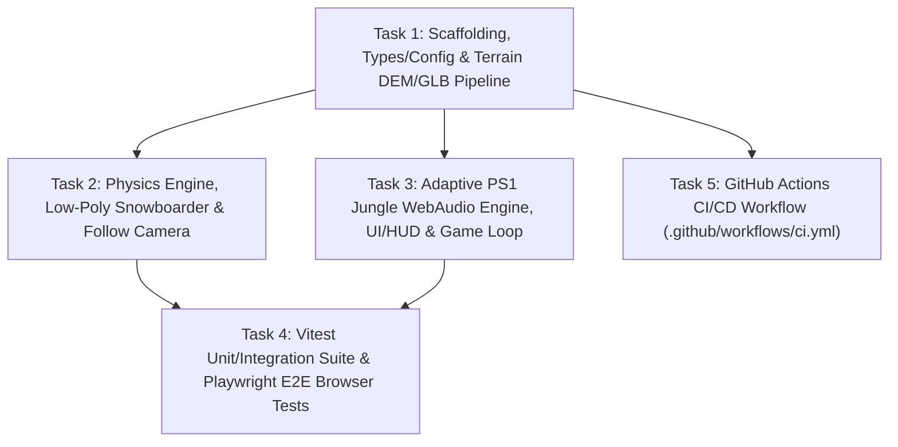

# Iteration 1 Task Decomposition (`feat/v1-core-game`)

This document decomposes Iteration 1 (`feat/v1-core-game`) into five self-contained tasks for Execution, Testing, and CI/CD Sub-Agents. Every Sub-Agent MUST read `wiki/interfaces.md` and `wiki/adr/0001-*.md` through `0005-*.md` before writing code.

---

## Execution Order & Parallelism Graph

- **Wave 1 (Foundation):** Task 1 sets up `package.json`, `tsconfig.json`, `vite.config.ts`, `.gitignore`, `src/types.ts`, `src/config.ts`, and `src/terrain/*` (plus `public/assets/whistler-peak.glb`), and installs dependencies (`npm install`).
- **Wave 2 (Parallel Core Implementation):** Task 2 (`src/physics/*`, `src/player/*`, `src/camera/*`), Task 3 (`src/audio/*`, `src/ui/*`, `src/main.ts`, `index.html`, `src/style.css`), and Task 5 (`.github/workflows/ci.yml`) can execute in parallel with zero file overlap.
- **Wave 3 (Verification & E2E):** Task 4 writes and executes the unit/integration tests (`tests/unit/*`) and Playwright E2E browser tests (`tests/e2e/*`, `playwright.config.ts`) against the integrated application.

---

## Task 1: Scaffolding, Shared Contracts & Flagship Mountain DEM/GLB Pipeline

- **Assigned Role:** Execution Sub-Agent 1 (Scaffolding & Terrain/GLB Pipeline)
- **Owned Files:**
  - `.gitignore`
  - `package.json`
  - `tsconfig.json`
  - `vite.config.ts`
  - `src/types.ts`
  - `src/config.ts`
  - `src/terrain/glbPipeline.ts`
  - `src/terrain/TerrainManager.ts`
  - `scripts/generate-glb.ts`
  - `public/assets/whistler-peak.glb`
- **Detailed Requirements:**
  1. Create `.gitignore` ignoring `node_modules/`, `dist/`, `.logs/`, `playwright-report/`, and `test-results/`.
  2. Create `package.json` with dependencies `three` (`^0.169.0`), `cannon-es` (`^0.20.0`), and devDependencies `typescript` (`^5.6.0`), `vite` (`^5.4.0`), `@types/three` (`^0.169.0`), `vitest` (`^2.1.0`), `jsdom` (`^25.0.0`), `@playwright/test` (`^1.48.0`), `tsx` (`^4.19.0`). Run `npm install`.
  3. Create `tsconfig.json` and `vite.config.ts`.
  4. Implement `src/types.ts` and `src/config.ts` matching `wiki/interfaces.md` verbatim.
  5. Implement `src/terrain/glbPipeline.ts`:
     - `generateWhistlerDEM(width = 400, length = 1200, segmentsX = 64, segmentsZ = 192): TerrainData` generating a realistic downhill ski mountain heightfield (Whistler Peak Express to Glacier Bowl) with alpine bowls, ridges, rollers, 3 drop zones (`DEFAULT_GAME_CONFIG.dropZones`), and natural obstacles (`tree`, `rock`, `cliff`) keeping a 25m clear radius around each drop zone spawn point.
     - `buildTerrainMeshFromDEM(data: TerrainData): THREE.Mesh` with low-poly flat-shaded vertex colors (`flatShading: true`).
     - `exportTerrainToGLBBuffer(mesh: THREE.Object3D): Promise<ArrayBuffer>` and `parseTerrainFromGLBBuffer(buffer: ArrayBuffer): Promise<THREE.Group>` creating/parsing valid binary glTF 2.0 (`.glb`, magic header `0x46546C67`). Note: ensure `exportTerrainToGLBBuffer` works in both browser and Node/Vitest (converting or polyfilling `FileReader` / binary buffer if needed, or constructing a valid glTF 2.0 binary `.glb` chunk + using `GLTFLoader`).
  6. Generate `public/assets/whistler-peak.glb` via `scripts/generate-glb.ts` so the static `.glb` file exists on disk.
  7. Implement `src/terrain/TerrainManager.ts` with `initialize(glbUrl?)`, `getHeightAt(x, z)`, `getNormalAt(x, z)`, `getSlopePitchAt(x, z, headingRad)`, `checkObstacleCollision(position, radius)`, and low-poly 3D obstacle meshes (pine trees, jagged rocks, cliff faces) attached to `rootGroup`.

---

## Task 2: Physics Engine, Low-Poly Snowboard Character, Controls & Dynamic Camera

- **Assigned Role:** Execution Sub-Agent 2 (Physics, Character & Camera)
- **Owned Files:**
  - `src/physics/PhysicsEngine.ts`
  - `src/player/PlayerController.ts`
  - `src/player/SnowboardCharacter.ts`
  - `src/camera/FollowCamera.ts`
- **Detailed Requirements:**
  1. Implement `src/physics/PhysicsEngine.ts` adhering strictly to `wiki/interfaces.md` and `ADR-0003`:
     - Uses `cannon-es` (`CANNON.World`, `CANNON.Body`) coupled with `TerrainManager.getHeightAt(x, z)` and `getNormalAt(x, z)`.
     - Implements slope-driven gravity acceleration, steering yaw (`headingRad`), board roll (`rollRad`), carving edge angle & deceleration (`carveIntensity`, `carveAngleRad`, `carveDragCoefficient`), aerodynamic tuck boost (`input.tuck`), jump impulse (`input.jump`) & `airtimeSeconds` tracking, obstacle collision detection (`isCrashed`, `crashTimerSeconds` recovery), and lateral/bottom boundary handling.
  2. Implement `src/player/PlayerController.ts` supporting keyboard (`WASD`, Arrow keys, `Space`, `R`), Gamepad API polling, and programmatic test overrides (`setOverride`).
  3. Implement `src/player/SnowboardCharacter.ts` building a nostalgic PS1 low-poly snowboarder mesh (board, bindings, rider legs, torso, jacket, arms, head with goggles/beanie) and snow spray particles that scale with `carveIntensity` and speed.
  4. Implement `src/camera/FollowCamera.ts` with smooth third-person chase tracking, slope pitch tilt, terrain-clearance clamping, and speed-reactive FOV (`cameraBaseFov` to `cameraMaxFov`).

---

## Task 3: Adaptive PS1 Jungle WebAudio Engine, UI/HUD & Game Loop Coordinator

- **Assigned Role:** Execution Sub-Agent 3 (Audio, UI/HUD & Main Coordinator)
- **Owned Files:**
  - `src/audio/JungleAudioEngine.ts`
  - `src/ui/HUDManager.ts`
  - `src/main.ts`
  - `src/style.css`
  - `index.html`
- **Detailed Requirements:**
  1. Implement `src/audio/JungleAudioEngine.ts` adhering strictly to `wiki/interfaces.md` and `ADR-0004`:
     - Deterministic `update(playerState, dtSeconds): AudioState` calculating `padGain`, `bassGain`, `drumGain`, `windGain`, `windFrequencyHz`, `carveGain`, `carveFrequencyHz`, and `activeStems` based on `speedKmh`, `carveIntensity`, `isGrounded`, and `isCrashed`.
     - Procedural Web Audio API 170 BPM PS1 Jungle synthesizer (detuned atmospheric minor-9th pad oscillators, Reese/sub-bass oscillator, 16-step Amen breakbeat drum pattern with kick/snare/chopped hats, bandpass-filtered wind noise, and bandpass-filtered snow carve noise).
  2. Implement `src/ui/HUDManager.ts` and `src/style.css` with retro PS1 extreme-sports styling:
     - Main menu (`#main-menu`) displaying mountain overview and clickable drop-zone buttons (`[data-testid="drop-zone-btn-summit-express"]`, `[data-testid="drop-zone-btn-harmony-ridge"]`, `[data-testid="drop-zone-btn-glacier-bowl"]`).
     - In-game HUD (`#hud-overlay`) displaying live speed (`[data-testid="hud-speed"]`), altitude (`[data-testid="hud-altitude"]`), active audio stems badge (`[data-testid="hud-stems"]`), carve/airtime/crash status banners, mute toggle (`[data-testid="btn-mute-audio"]`), and return-to-menu button (`[data-testid="btn-return-menu"]`).
  3. Implement `src/main.ts` (`GameApp`) and `index.html`:
     - Wires `TerrainManager`, `PhysicsEngine`, `PlayerController`, `SnowboardCharacter`, `FollowCamera`, `JungleAudioEngine`, and `HUDManager` into a Three.js scene with alpine sky lighting and fog.
     - Gracefully handles WebGL context creation in headless environments.
     - Publishes `window.__OGSNOW_STATE__` and `window.__OGSNOW_APP__` (`dropIn`, `returnToMenu`, `stepSimulation`, `setInputOverride`, `triggerCrashForTest`) on every frame and state transition.

---

## Task 4: Automated Unit/Integration Tests (Vitest) & E2E Browser Verification (Playwright)

- **Assigned Role:** Testing & Playwright E2E Sub-Agent
- **Owned Files:**
  - `tests/unit/terrain.test.ts`
  - `tests/unit/physics.test.ts`
  - `tests/unit/audio.test.ts`
  - `tests/e2e/gameplay.spec.ts`
  - `playwright.config.ts`
- **Detailed Requirements:**
  1. Write unit/integration tests in `tests/unit/` covering:
     - `terrain.test.ts`: Whistler DEM elevation profile (summit higher than base), bilinear height/normal accuracy, obstacle collision checks, drop-zone spawn safety, `.glb` binary export (`0x46546C67` header) and parse roundtrip.
     - `physics.test.ts`: Gravity acceleration down slope, left/right steering heading changes, carving deceleration & `carveIntensity`, jump & airtime tracking, obstacle crash & recovery timer.
     - `audio.test.ts`: Adaptive stem progression (`['pad']` at 0 km/h -> `['pad', 'bass']` at 22 km/h -> `['pad', 'bass', 'drums']` at 65 km/h), crash ducking back to `['pad']`, wind pitch/gain scaling with speed, snow carve SFX scaling with carve intensity and zeroing when airborne.
  2. Configure `playwright.config.ts` and write `tests/e2e/gameplay.spec.ts`:
     - Launch the game in headless Chromium with WebGL flags (`--use-gl=angle`, `--use-angle=swiftshader`, `--enable-webgl`, `--ignore-gpu-blocklist`).
     - Assert zero `console.error` and zero `pageerror` events.
     - Verify main menu rendering, drop-zone selection (`summit-express`, `harmony-ridge`), `.glb` terrain loading state (`terrain.glbLoaded === true`), downhill momentum buildup, steering/carving controls, adaptive audio stem state transitions in `window.__OGSNOW_STATE__.audio`, HUD telemetry updates, and crash ducking recovery.
  3. Run `npm run build`, `npm test`, and `npm run test:e2e` and verify 100% pass rate.

---

## Task 5: GitHub Actions CI/CD & Automated GitHub Pages Deployment Pipeline

- **Assigned Role:** CI/CD & GitHub Pages Sub-Agent
- **Owned Files:**
  - `.github/workflows/ci.yml`
  - `vite.config.ts` (base path configuration)
- **Detailed Requirements:**
  1. Create and maintain `.github/workflows/ci.yml` triggered on `push` (`main`, `master`, `feat/**`) and `pull_request`.
  2. Configure top-level workflow permissions (`contents: read`, `pages: write`, `id-token: write`) and concurrency group (`group: 'pages'`, `cancel-in-progress: false`).
  3. Configure Node.js 20 with `npm` caching, install dependencies (`npm ci`), install Playwright Chromium (`npx playwright install --with-deps chromium`), run `npm run build`, `npm test`, and `npm run test:e2e`.
  4. Upload Pages artifact using `actions/upload-pages-artifact@v3` (`path: ./dist`) in `build-and-test` after all tests pass.
  5. Add `deploy-pages` job (`needs: build-and-test`, runs on push to `main`, `master`, or `feat/**`) deploying via `actions/deploy-pages@v4` to `github-pages` environment with URL output `${{ steps.deployment.outputs.page_url }}` for live browser testing of feature branches and releases.
  6. Ensure `vite.config.ts` sets `base: './'` and all static assets in code (e.g. `src/terrain/TerrainManager.ts`, `src/main.ts`) reference relative paths (`'./assets/whistler-peak.glb'`) for seamless operation on GitHub Pages project subpaths (`/ogsnow/`).
